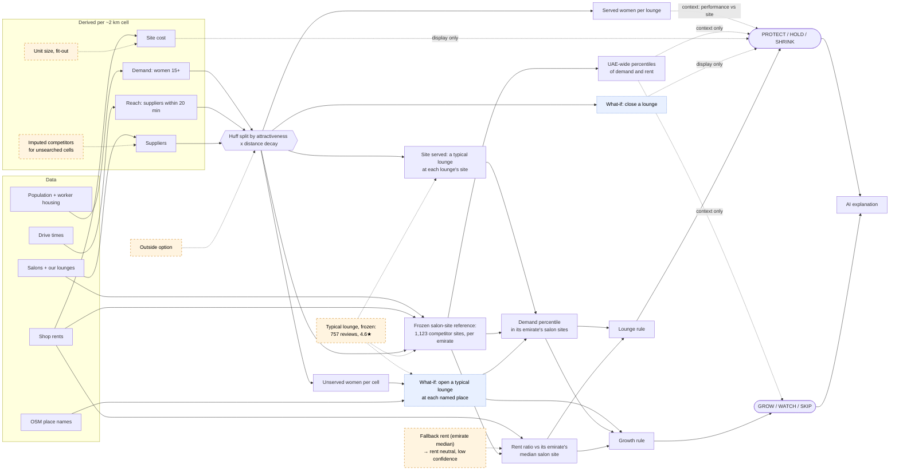
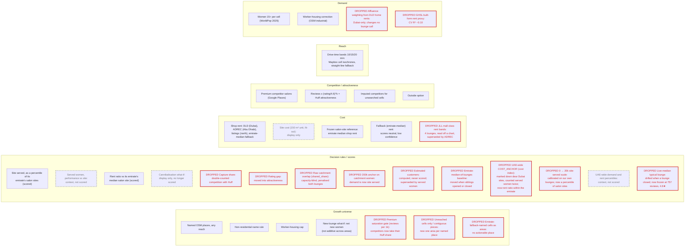

# Bedashing network right-sizing

A decision-support app for Bedashing Beauty Lounge's UAE network. It scores each of the 24 lounges
**PROTECT / HOLD / SHRINK** and each named populated place (OSM) **GROW / WATCH / SKIP**, from a women-15+ market estimate, drive-time reach, Google Places competitors
(a Huff split of each cell's women across our lounges and premium salons) and shop rents, each site judged against its emirate's market of competitor salon sites. Every call comes with an AI-written explanation, and every number in that explanation
is checked against the data.

**Live app:** https://2pz-ai-case-study-wr7zdmdumqywtp8bvpmbxm.streamlit.app/

## The questions it answers

The app is for Bedashing's **retail portfolio team** (network, real estate, expansion) and the
network and capital owner on it, to answer five questions. Each answer below is the model's current baseline
(all counts of women are model estimates), and where in the app to see it.

1. **Which lounges should we keep, watch or review?**
   **6 PROTECT, 14 HOLD, 3 SHRINK** of 23 scored lounges (the airport lounge isn't scored).
   - PROTECT: Al Ain, Al Dhafra, Al Falah, Al Taif Mall, Mirdif 35, Nad Al Sheba.
   - SHRINK (investigate, don't close: we can't see profit): Al Jada, City Walk, West Yas.
   - Each site is judged within its emirate on two things: how much of the market a typical lounge there would serve, and its commercial rent.
   - **Where:** the Executive Summary's Review and Protect sections; the Lounges page for every lounge and its "What would change the call" tree.
2. **Where is there room for a new lounge?**
   **34 GROW areas** pass all three tests: 6,000+ net new women, demand in the emirate's top half, and rent no dearer than its median salon site.
   - The biggest are Al Dhaid (+35% on the women our lounges serve today), Manama (+21%) and Khor Fakkan (+14%).
   - These figures can't be added up: neighbouring areas reach the same women.
   - About half the GROW areas are judged on the emirate's median rent, because we have no observed rent there, so they are low confidence.
   - **Where:** the Executive Summary's Grow section; the Areas page; the What-if explorer's map (GROW areas in blue).
3. **Where do our own lounges compete for the same women?**
   Almost everywhere on the map, yet barely in effect.
   - 19 of 24 lounges share more than half their catchment with a sibling.
   - If one closes, its siblings pick up a median **8%** of its customers (30% at most). The rest go to competitors or nowhere.
   - So overlap isn't treated as a reason to shrink, and expanding both lounges in a shared catchment can be right if it raises our coverage.
   - **Where:** each lounge page's shared-catchment table and cannibalisation what-if; the What-if explorer's "All catchments (overlap)" layer and **Test a SHRINK**.
4. **How does each lounge stand against the salons around it?**
   Each lounge's site demand comes from splitting every area's women across our lounges and the 1,100+ premium competitor salons around it (a Huff model), then ranking that against its emirate's competitor salon sites.
   - Example: City Walk out-serves only 30% of Dubai's salon sites; Al Dhafra out-serves all of Abu Dhabi's.
   - "The model estimates this lounge is performing N.Nx compared to its site" separates a strong lounge from a strong location.
   - **Where:** each lounge page's signals, factor tree and competitors table; premium competitors on the What-if explorer's map.
5. **How can the team see and test these answers for themselves?**
   - **Executive Summary:** the answer first, then the evidence for each claim, each with its own map.
   - **What-if explorer:**
     - change drive time, competitor coverage or worker-housing share, or close lounges, and watch the calls move;
     - a map that colours every area (GROW, already captured, WATCH, SKIP), with city jump buttons;
     - the only page a what-if touches.
   - **Lounges and Areas:** sortable tables that open each item's detail, its factor tree shaded red to green, and how its estimates move with each assumption.
   - **How it works:** this README, the model write-up and the implementation notes, with the limitations.

## Look at this in 5 minutes

1. **[Executive Summary](https://2pz-ai-case-study-wr7zdmdumqywtp8bvpmbxm.streamlit.app/):** the
   portfolio team's question answered in one line (at the 2026-10-11 baseline: *review 3 weak lounge sites,
   defend 6 strong ones and test 34 areas for new lounges, most of them in Abu Dhabi and Sharjah*),
   then three cards in % of our served market, the ~164k women our lounges serve today (model
   estimate): **Review** 3 lounges, 7%; **Grow** 34 areas, the best (Al Dhaid) +35%; **Protect** 6
   lounges, 37%. Each card's evidence follows below as a map and a table whose names link to the
   lounge or area page, then *How sure we are*.
2. **[What-if explorer](https://2pz-ai-case-study-wr7zdmdumqywtp8bvpmbxm.streamlit.app/explore):
   pick "Abu Dhabi" and tick "All catchments (overlap)"**: the city cluster, where siblings
   and premium salons split the same women. Overlap alone doesn't make a SHRINK: judged against Abu
   Dhabi's salon sites, only westyas there is SHRINK; delma, noya-plaza and the rest are HOLD.
3. **[city-walk](https://2pz-ai-case-study-wr7zdmdumqywtp8bvpmbxm.streamlit.app/lounge?lounge=city-walk)
   (SHRINK):** a typical lounge at its site would serve about 1.9k women in the Huff split: bottom
   30% of Dubai salon sites on demand (26th percentile UAE-wide), at a rent ratio of 0.47 (its DLD area's
   DLD rent, dearer than the median Dubai salon site; 98th percentile UAE-wide). The AI pyramid with
   *so what / now what*, *What would change the call* and the factor tree (each scored row shaded
   red to green by how it pushes the call), a tab per assumption, its premium competitors and which
   siblings share its women. High confidence: the call holds in all 27 drive-time x coverage x
   worker-share combinations.
4. **[Kalba](https://2pz-ai-case-study-wr7zdmdumqywtp8bvpmbxm.streamlit.app/area?area=kalba-sharjah)
   (GROW):** a typical new lounge there would add about 12.5k net new women against a 6,000 line,
   top 10% of Sharjah salon sites on demand (98th percentile UAE-wide); low confidence. Kalba has
   no shop rent of its own (its cells take Sharjah's emirate median), so the rent test is neutral
   rather than passed, and the call says so (limitations 3).
5. **The fallback:** on the What-if explorer, open **🧪 Change the assumptions, or test a SHRINK**
   (say drive time 20 min, or close a lounge) and click a lounge on the map: where the numbers
   change, the text switches to the labelled template. Only that page reads the what-if; the other
   pages always show the baseline.
6. **[How it works & limitations](https://2pz-ai-case-study-wr7zdmdumqywtp8bvpmbxm.streamlit.app/how)**,
   then the limitations below.

The full ten-minute version, with the AI layer and where not to trust it:
[`docs/walkthrough.md`](docs/walkthrough.md).

## Read this first: limitations

This is a first pass we will iterate on. The calls are **a shortlist to test with the business, not
decisions**, and the limitations matter more than the calls. The biggest ones:

- **No revenue or lease data in the model.** The cost signal is a shop rent (an area median, a
  district rate or an asking rent, not the lease) against its emirate's median salon site. No revenue, lease terms, actual capex or footfall. **SHRINK means "investigate", not
  "close".**
- **Served demand rests on lifetime Google review counts.** Each salon's pull in the Huff split is
  its reviews, so older salons look bigger and new lounges look weak; the Huff parameters are an
  uncalibrated first cut.
- **Shop rent comes from different sources per emirate.** DLD contracts (Dubai), ADREC district
  rates read by hand off its public map (Abu Dhabi), Property Finder / Bayut asking rents scraped
  via third-party Apify actors, a grey area under those portals' terms (northern emirates), else the
  emirate median. The rent ratio compares a site only with its own emirate's salon sites. A cell on
  the emirate-median fallback has no rent of its own, so where it sets the rent the rent test is
  neutral and the call low confidence: 17 of the 34 GROW areas (9 in Sharjah) and two PROTECT
  lounges (al-ain, al-falah).
- **The calls move with the assumptions.** 12 of the 23 scored lounges are low confidence: 10
  within 0.05 of a line, plus al-ain (fallback rent) and jumeirah-park, whose calls change in 9 of
  the 27 drive-time x coverage x worker-share combinations. Affluence weighting is off at baseline: every woman counts the same.
- **Drive times are midday**, and the competitor search misses smaller salons where Google's
  20-result cap bites.
- **The yardstick and thresholds are judgement.** Both signals rank a site within its emirate
  against a frozen set of 1,123 competitor salon sites, valued by the same uncalibrated served model;
  emirates with under 50 such sites are ranked UAE-wide on demand. Every score is shown with its
  UAE-wide percentile as context.

The full ranked list, with which calls each limitation touches and what would fix it:
[`docs/limitations.md`](docs/limitations.md), also the app's **How it works & limitations** page.

## Who it's for, and what it decides

| Role | Who | Uses it to |
|---|---|---|
**Who decides:** the owner of the network's footprint and capital, on the retail portfolio team. They decide where Bedashing is present and how much capital each site ties up: open, renew, resize, relocate or exit (access to market and deployment of capital). They don't run the branches: service quality, staffing and day-to-day performance belong to operations. So every call answers 'is this a good place to have our capital?', never 'is this branch well run?'

| Role | Who | Uses it to |
|---|---|---|
| **Primary user** | Bedashing's retail portfolio team (network, real estate, expansion) | form recommendations, stress-test them with what-ifs, lift the explanations into memos |
| **Decision-maker** | The network and capital owner, on the portfolio team: where Bedashing is present and how much capital each site ties up | open, renew, resize, relocate or exit, from the headline and the reasons |
| **Operations** (out of scope) | Whoever runs the branches: service quality, staffing, day-to-day performance | nothing here: the tool never judges how a branch is run |
| **Board** | PE owner's board / operating partner | judge whether the call is defensible: evidence, thresholds, caveats |

Each label maps to a decision the network and capital owner already makes (definitions: [`docs/glossary.md`](docs/glossary.md), "Decisions"):

| Their decision | Label | What it asks |
|---|---|---|
| **Lease renewal, resize or exit** (each lounge, at its lease event) | **PROTECT** | Keep and defend: renew, don't relocate, respond to a competitor opening nearby |
| | **HOLD** | No portfolio action this cycle; revisit at the next lease event, or sooner if a signal crosses a line |
| | **SHRINK** | Investigate, don't close: before the lease event, review downsizing or consolidating into the sibling that shares most of its catchment |
| **Open** (site search, expansion plan) | **GROW** | Start a site search: a shortlist for site visits, verified on the ground before committing |
| **Revisit later** | **WATCH** | Don't act now; revisit when the named failing test changes |
| **No action** | **SKIP** | Too small or already crowded. (The airport lounge is NOT SCORED: it serves travellers.) |

**North star: services delivered**, the demand our lounges actually serve, bounded by their
capacity. The model can't measure it yet. Its nearest proxy is **served women** (the Huff split),
shown as context; the scorecard's demand signal is **site served**, the women a typical lounge would
serve at the site, so the calls judge the site, not the lounge's own popularity. **Capacity is not modelled at all** (no chairs, hours or
utilisation), so the model can't tell a full lounge from an empty one, and a SHRINK is driven by
modelled demand and shop rent, not by services that would be lost. Read the calls with that in mind.

**One flow, question to action.** *"Which lounges should we review before their leases?"* →
Executive Summary: the Review card and its evidence map and table show 3 SHRINKs, one per emirate
(city-walk, westyas, al-jada) → click **city-walk** in the table → its page: a typical lounge at its site would serve about 1.9k women, bottom 30% of
Dubai salon sites on demand (26th percentile UAE-wide), at a rent ratio of 0.47 (98th percentile of
rent UAE-wide); 72% of its catchment women are also reached by a sibling (the shared-women table
names which), and the call is high confidence: it holds in all 27 assumption combinations → action:
put city-walk on the lease-review list with the sibling named, and ask finance for its P&L before
anyone says "close" (a prime rent may be buying footfall the model can't see).

**Why a hosted web app.** The decision-maker opens a link: nothing to install, and every lounge and area has
its own URL, so a recommendation can be sent as a link to the evidence. The portfolio team runs
what-ifs in the same place the decision-maker reads the answer, and the board sees the same numbers.

## Out of scope, and why

Our job ends at **allocating lounges to neighbourhoods**: where the network should be denser,
thinner or new. Out of scope:

- **The P&L: revenue, actual rent paid, capex, lease terms.** We have none of it, and it is Bedashing's own
  data. It decides whether a SHRINK is closed; the model only says which lounges to look at.
- **In-branch staffing and capacity.** How many chairs and stylists a lounge needs is an
  operations question, answered from bookings, not from maps.
- **Service quality and operations.** Ratings enter only as part of each salon's pull in the
  Huff split; fixing a weak lounge's service is a management job, not a location one.

## What it currently says

At the baseline (2026-10-11: 15-min drive, 60% competitor coverage, 5.5% women in worker housing,
affluence off):

- **Lounges:** 6 PROTECT (al-taif-mall, al-ain, mirdif-35, al-falah, al-dhafra, nad-al-sheba),
  14 HOLD, 3 SHRINK, 1 NOT SCORED (the airport lounge serves travellers). **12 of 23** calls are low
  confidence: 10 within 0.05 of a line (5 of them Abu Dhabi HOLDs just above the SHRINK line, and
  al-falah just above PROTECT), plus al-ain and jumeirah-park (its call changes in 9 of the 27
  drive-time x coverage x worker-share combinations); al-ain and al-falah have the Abu Dhabi median as
  their site rent (fallback), so rent scores neutral.
  khalifa-city-a is HOLD on its site (top 27% of Abu Dhabi salon sites on demand, but rent ratio
  0.62), though the model estimates it is performing 2.7x compared to its site (context, not scored).
- **The 3 SHRINKs:** city-walk (bottom 30% of Dubai salon sites on demand, rent ratio 0.47), westyas
  (bottom 45% of Abu Dhabi's, 0.82) and al-jada (top 34% of Sharjah's on demand, but rent ratio 0.63:
  it sits on the dear Dubai edge of Sharjah). Each site is weak for its own emirate's salon market.
  Investigate, don't cut.
- **Growth areas:** 34 GROW and 63 WATCH out of 561. GROW is in Abu Dhabi (13), Sharjah (10), Ajman
  (6), Ras Al Khaimah (4) and Dubai (1, Al Awir). Most big WATCHes (al-dhahir, bani-yas, al-helio)
  have the women but a shop rent dearer than their emirate's median salon site. Most of the Sharjah ones are beyond a 15-minute drive
  of Bedashing's two Sharjah lounges (al-jada, zawaya-walk, both on the Dubai side); why the footprint
  there is only two is a business question the model can't answer (licensing, brand fit, landlords).
  17 of the 34 GROW areas (Sharjah 9, Ras Al Khaimah 4, Ajman 2, Dubai 1, Abu Dhabi 1) have a rent
  that is mostly the emirate-median fallback: their rent test is neutral and the call low
  confidence. Net new women are not additive across areas: each what-if runs alone, so
  neighbouring GROW areas count the same women. The northern-emirates rent checks use scraped asking rents
  (see limitations).

Treat these as the places to look first, not as answers.

## Run it

Prerequisites: Python ≥ 3.11, [uv](https://docs.astral.sh/uv/) and (optional)
[just](https://just.systems/).

```bash
uv sync --extra dev
uv run streamlit run streamlit_app.py     # http://localhost:8501  (or: just app)
```

No API key needed: the app computes everything in memory from the committed `data/seed/v3/` and
serves the committed AI explanations. `just test` runs the tests. `just labels` prints every
lounge and growth-area call at the baseline as CSV. `just notebook` opens the notebooks (start
with `scorecard.ipynb`).

## Using the app

Five pages; the loop is **Executive Summary → click a lounge or area → its page → back**.

1. **Executive Summary** (`/overview`): the portfolio team's question, one governing thought, a *How we measure*
   note (the two proxies and why each threshold sits where it does) and the AI-written summary, then
   three cards (**Review**, **Grow**, **Protect**), each a claim with its share of our served market
   (model estimate). Below them, each card's evidence: a map and a table (composite, share of
   market, out-serves, rent ratio, performance vs its site, confidence; est. growth for areas) whose
   names link to the lounge or area page. Last, **How sure we are**: the HOLDs, the low-confidence
   calls by name, a branch-health KPI box (what each KPI rests on today and the data that would make
   us surer) and the limitations box.
2. **What-if explorer** (`/explore?lounge=delma` or `?area=kalba-sharjah` preselects): the only page
   that reads the what-if. On top, always, the **scenario summary** (Baseline | This scenario |
   Change: lounge calls, low confidence, GROW/WATCH/SKIP, women served, best growth) and **What
   changed** (~~HOLD~~ → **SHRINK**, with the signal that moved). **🧪 Change the assumptions, your
   decision rules or a rent, or test a SHRINK** (collapsed at baseline): drive time, competitor
   coverage, worker housing and search recall; *Your decision rules* (demand vs rent weight, PROTECT
   and SHRINK lines, GROW minimum and demand line); *Plug in a quote* (a rent for a lounge or growth
   area); *Test a SHRINK* closes lounges. Example: a landlord quote of AED 2,200/m² for City Walk
   (today 4,561) turns it ~~SHRINK~~ → **HOLD** (low confidence; the line is about 2,290); a GROW
   minimum of 10,000 net new women cuts GROW from 34 to 16 areas. Then the map: every area coloured by its call (GROW blue,
   already captured green, WATCH purple, SKIP grey), lounge pins in their call's colour (hollow =
   low confidence), **Jump to** city pills, toggles for premium substitutes (selected lounge or
   every lounge) and **all catchments (overlap)**, and a collapsible legend. Click a lounge or area
   for its short pyramid, tests and caveats, and a link to its page.
3. **Lounges** (`/lounge?lounge=delma`): the table of all 24 lounges, filterable by call and
   emirate and sortable, is the picker: select a row and its detail opens below: address and rating,
   the call with its pyramid and caveats, its catchment map, the two signals on their scales,
   *What would change the call* and the factor tree (call, signals, their inputs; scored rows shaded
   red to green), a tab per assumption showing how its estimates and call move, its premium
   competitors table and its shared catchment (which siblings reach its women, and what share they'd
   absorb if it closed).
4. **Areas** (`/area?area=kalba-sharjah`): the GROW and WATCH areas ranked by net new women, the
   same table-as-picker; below, the call with its pyramid and caveats, *How this call was made*
   (the three tests), the factor tree, the per-assumption tabs, a map of its cells and the nearest
   lounge.
5. **How it works & limitations:** this README, [docs/model.md](docs/model.md) and
   [docs/implementation.md](docs/implementation.md), then live values read from the code each load: every
   assumption with its source and every constant with why it was chosen.

Links carry the selection, so any page can be shared directly. Guided tour: [`docs/walkthrough.md`](docs/walkthrough.md).

## How the model works

One chain: **where the women are → who can reach them → who they go to → what a site costs → the
call.** The rules make every call; the AI only narrates it. Constants are named in [docs/model.md](docs/model.md), not quoted,
because they are still being tuned: each lives in code with a `*_WHY` string saying why. The first
diagram is that chain; the second lists every signal behind it, including the ones we dropped.

**The model: from data to calls**



*Dashed orange = an assumption, not data. Dashed blue = a what-if the model simulates.*

**Signals and features**



*Plain = in use. Red = dropped, with the reason. Grey dashed = demoted: still computed and shown,
no longer scored.*

The full write-up, step by step, with every proxy, threshold, ignored factor and assumption: [docs/model.md](docs/model.md). The AI layer, data pipeline, tools, trade-offs and improvements: [docs/implementation.md](docs/implementation.md).

## Repo map

```
streamlit_app.py         entry point; pages in src/webapp/pages/ (overview, lounge, area, how)
src/webapp/              map layers, shared rendering, the what-if panel
src/data_v3.py           loads data/seed/v3/
src/market.py            women 15+ per cell, affluence weight, premium substitutes, capture
src/model/served.py      Huff served demand, leave-one-out, open-a-lounge what-if
src/features/lounges.py  catchments, lounge features, site cost, salon-site reference signals (demand percentile, rent ratio), growth areas
src/model/scorecard.py   lounge signals, scales, weights, thresholds, confidence (with the reasons)
src/model/growth.py      GROW / WATCH / SKIP tests (with the reasons)
src/baseline.py          one in-memory run per what-if, and its diff against the baseline
src/explain.py           fact sheets, prioritisation, grounding check, cache, prompts
scripts/                 one-off fetches and builds (Google Places, Mapbox, WorldPop/OSM cells, GHSL, DLD rents, shop rents)
notebooks/               market_size, catchments, competitors, served_demand, rent, scorecard, growth, branches; features/: affluence, features, decisions, explanations
docs/limitations.md      ranked limitations: read first
docs/model.md            the model in detail: steps, proxies, ignored factors, assumptions and evidence
docs/implementation.md   the AI layer, data, tools, trade-offs, potential improvements
docs/glossary.md         glossary of domain terms and decisions
```

Commands: `just app` · `just test` · `just labels` · `just notebook` · `just explain`.
