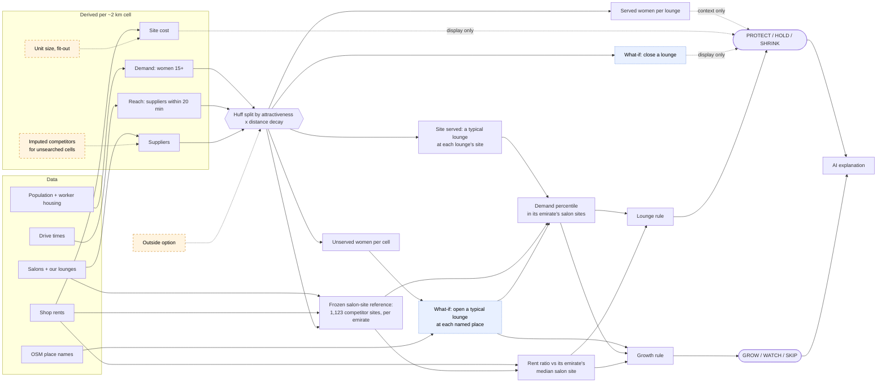
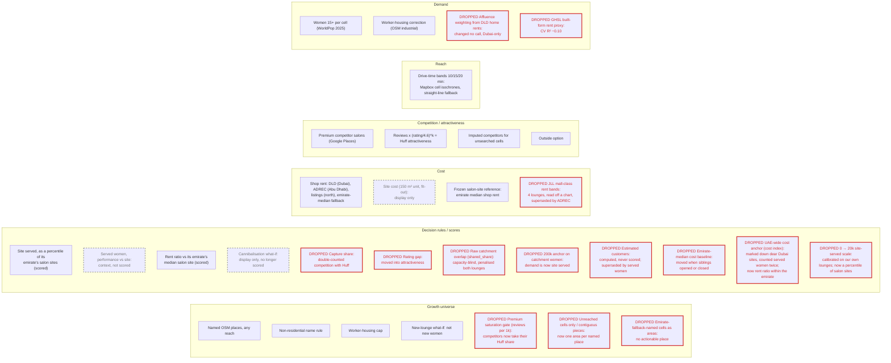

# Bedashing network right-sizing

A decision-support app for Bedashing Beauty Lounge's UAE network. It scores each of the 24 lounges
**PROTECT / HOLD / SHRINK** and each populated area beyond a 15-minute drive of every lounge
**GROW / WATCH / SKIP**, from a women-15+ market estimate, drive-time reach, Google Places competitors
(a Huff split of each cell's women across our lounges and premium salons) and shop rents, each site judged against its emirate's market of competitor salon sites. Every call comes with an AI-written explanation, and every number in that explanation
is checked against the data.

**Live app:** https://2pz-ai-case-study-wr7zdmdumqywtp8bvpmbxm.streamlit.app/

## Look at this in 5 minutes

1. **[Overview](https://2pz-ai-case-study-wr7zdmdumqywtp8bvpmbxm.streamlit.app/):** the COO's
   question, the executive summary and three at-stake figures (at the 2026-10-11 baseline: 3 SHRINK
   lounges, about 323k women in shared cells; 32 GROW areas, about 784k women).
2. **Tick "All catchments (overlap)"** above the map: the Abu Dhabi city cluster, where siblings
   and premium salons split the same women. Overlap alone doesn't make a SHRINK: judged against Abu
   Dhabi's salon sites, only westyas there is SHRINK; delma, noya-plaza and the rest are HOLD.
3. **[city-walk](https://2pz-ai-case-study-wr7zdmdumqywtp8bvpmbxm.streamlit.app/lounge?lounge=city-walk)
   (SHRINK):** a typical lounge at its site would serve about 1.9k women in the Huff split: bottom
   30% of Dubai salon sites on demand (26th percentile UAE-wide), at a rent ratio of 0.47 (its DLD area's
   DLD rent, dearer than the median Dubai salon site; 98th percentile UAE-wide). The AI pyramid with
   *so what / now what*, the factor table's contributions, which siblings share its women and *What
   would change the call*. High confidence: it holds in all 81 assumption combinations.
4. **[Kalba](https://2pz-ai-case-study-wr7zdmdumqywtp8bvpmbxm.streamlit.app/area?area=kalba-sharjah)
   (GROW):** a typical new lounge there would add about 12.5k net new women against a 6,000 line,
   top 10% of Sharjah salon sites on demand (98th percentile UAE-wide), rent ratio 1.00; high
   confidence. That 1.00 is Sharjah's emirate-median rent, not Kalba's own: it passes the rent test
   by construction (limitations 3).
5. **The fallback:** change anything in the Overview's **🧪 What if…?** panel (say travel time 20
   min, or close a lounge): where the numbers change, the text switches to the labelled template.
6. **[How it works & limitations](https://2pz-ai-case-study-wr7zdmdumqywtp8bvpmbxm.streamlit.app/how)**,
   then the limitations below.

The full ten-minute version, with the AI layer and where not to trust it:
[`docs/walkthrough.md`](docs/walkthrough.md).

## Read this first: limitations

This is a first pass we will iterate on. The calls are **a shortlist to test with the business, not
decisions**, and the limitations matter more than the calls. The biggest ones:

- **No revenue or lease data in the model.** The cost signal is a shop rent (an area median, a
  district rate or an asking rent, not the lease) against its emirate's median salon site. No revenue, lease terms, actual capex or footfall. **SHRINK means "investigate", not
  "close".**
- **Served demand rests on lifetime Google review counts.** Each salon's pull in the Huff split is
  its reviews, so older salons look bigger and new lounges look weak; the Huff parameters are an
  uncalibrated first cut.
- **Shop rent comes from different sources per emirate.** DLD contracts (Dubai), ADREC district
  rates read by hand off its public map (Abu Dhabi), Property Finder / Bayut asking rents scraped
  via third-party Apify actors, a grey area under those portals' terms (northern emirates), else the
  emirate median. The rent ratio compares a site only with its own emirate's salon sites, but a cell
  on the emirate-median fallback lands at a ratio of about 1: all 10 Sharjah GROW areas pass the rent
  test that way, and manama-ajman misses it by 0.3%.
- **The calls move with the assumptions.** 9 of the 23 scored lounges are low confidence (all within
  0.05 of a line). Affluence weighting is off at baseline: every woman counts the same.
- **Drive times are midday**, and the competitor search misses smaller salons where Google's
  20-result cap bites.
- **The yardstick and thresholds are judgement.** Both signals rank a site within its emirate
  against a frozen set of 1,123 competitor salon sites, valued by the same uncalibrated served model;
  emirates with under 50 such sites are ranked UAE-wide on demand. Every score is shown with its
  UAE-wide percentile as context.

The full ranked list, with which calls each limitation touches and what would fix it:
[`docs/limitations.md`](docs/limitations.md), also the app's **How it works & limitations** page.

## Who it's for, and what it decides

| Role | Who | Uses it to |
|---|---|---|
| **Primary user** | Bedashing's portfolio team (network, real estate, expansion) | form recommendations, stress-test them with what-ifs, lift the explanations into memos |
| **Decision-maker** | COO, accountable for lounge operations and return on capital | approve or question the recommendation from the headline and the reasons |
| **Board** | PE owner's board / operating partner | judge whether the call is defensible: evidence, thresholds, caveats |

Each label maps to a decision the COO already makes (definitions: [`CONTEXT.md`](CONTEXT.md), "Decisions"):

| COO decision | Label | What it asks |
|---|---|---|
| **Lease renewal** (each lounge, at its lease event) | **PROTECT** | Keep and defend: renew, don't relocate, respond to a competitor opening nearby |
| | **HOLD** | No portfolio action this cycle; revisit at the next lease event, or sooner if a signal crosses a line |
| | **SHRINK** | Investigate, don't close: before the lease event, review downsizing or consolidating into the sibling that shares most of its catchment |
| **Site search** (expansion plan) | **GROW** | Start a site search: a shortlist for site visits, verified on the ground before committing |
| **Revisit later** | **WATCH** | Don't act now; revisit when the named failing test changes |
| **No action** | **SKIP** | Too small or already crowded. (The airport lounge is NOT SCORED: it serves travellers.) |

**North star: services delivered**, the demand our lounges actually serve, bounded by their
capacity. The model can't measure it yet. Its nearest proxy is **served women** (the Huff split),
shown as context; the scorecard's demand signal is **site served**, the women a typical lounge would
serve at the site, so the calls judge the site, not the lounge's own popularity. **Capacity is not modelled at all** (no chairs, hours or
utilisation), so the model can't tell a full lounge from an empty one, and a SHRINK is driven by
modelled demand and shop rent, not by services that would be lost. Read the calls with that in mind.

**One flow, question to action.** *"Which lounges should we review before their leases?"* →
Overview: the summary and map show 3 SHRINKs, one per emirate (city-walk, westyas, al-jada) → click
**city-walk** → its page: a typical lounge at its site would serve about 1.9k women, bottom 30% of
Dubai salon sites on demand (26th percentile UAE-wide), at a rent ratio of 0.47 (98th percentile of
rent UAE-wide); 72% of its catchment women are also reached by a sibling (the shared-women table
names which), and the call is high confidence: it holds in all 81 assumption combinations → action:
put city-walk on the lease-review list with the sibling named, and ask finance for its P&L before
anyone says "close" (a prime rent may be buying footfall the model can't see).

**Why a hosted web app.** The COO opens a link: nothing to install, and every lounge and area has
its own URL, so a recommendation can be sent as a link to the evidence. The portfolio team runs
what-ifs in the same place the COO reads the answer, and the board sees the same numbers.

## Out of scope, and why

Our job ends at **allocating lounges to neighbourhoods**: where the network should be denser,
thinner or new. Out of scope:

- **The P&L: revenue, actual rent paid, capex, lease terms.** We have none of it, and it is Bedashing's own
  data. It decides whether a SHRINK is closed; the model only says which lounges to look at.
- **In-branch staffing and capacity.** How many chairs and stylists a lounge needs is an
  operations question, answered from bookings, not from maps.
- **Service quality and operations.** Ratings are used only relative to nearby premium salons;
  fixing a weak lounge's service is a management job, not a location one.

## What it currently says

At the baseline (2026-10-11: 15-min drive, 60% competitor coverage, 5.5% women in worker housing,
affluence off):

- **Lounges:** 6 PROTECT (al-taif-mall, al-ain, mirdif-35, al-falah, al-dhafra, nad-al-sheba),
  14 HOLD, 3 SHRINK, 1 NOT SCORED (the airport lounge serves travellers). **11 of 23** calls are low
  confidence: 9 within 0.05 of a line (5 of them Abu Dhabi HOLDs just above the SHRINK line), and
  al-ain and al-falah, whose site rent is the Abu Dhabi median (fallback), so rent scores neutral.
  khalifa-city-a is HOLD on its site (top 27% of Abu Dhabi salon sites on demand, but rent ratio
  0.62), though the model estimates it is performing 2.7x compared to its site (context, not scored).
- **The 3 SHRINKs:** city-walk (bottom 30% of Dubai salon sites on demand, rent ratio 0.47), westyas
  (bottom 45% of Abu Dhabi's, 0.82) and al-jada (top 34% of Sharjah's on demand, but rent ratio 0.63:
  it sits on the dear Dubai edge of Sharjah). Each site is weak for its own emirate's salon market.
  Investigate, don't cut.
- **Growth areas:** 34 GROW and 63 WATCH out of 561. GROW is in Abu Dhabi (13), Sharjah (10), Ajman
  (6), Ras Al Khaimah (4) and Dubai (1, Al Awir). Most big WATCHes (al-dhahir, bani-yas, al-helio)
  have the women but a shop rent dearer than their emirate's median salon site. Most of the Sharjah ones are beyond a 15-minute drive
  of Bedashing's two Sharjah lounges (al-jada, zawaya-walk, both on the Dubai side); why the footprint
  there is only two is a business question the model can't answer (licensing, brand fit, landlords).
  17 of the 34 GROW areas (nine in Sharjah, plus manama-ajman and mudayrah-ajman, which this
  moved up from WATCH) have a rent that is mostly the emirate-median fallback: their rent test is
  neutral and the call low confidence. The northern-emirates rent checks use scraped asking rents
  (see limitations).

Treat these as the places to look first, not as answers.

## Run it

Prerequisites: Python ≥ 3.11, [uv](https://docs.astral.sh/uv/) and (optional)
[just](https://just.systems/).

```bash
uv sync --extra dev
uv run streamlit run streamlit_app.py     # http://localhost:8501  (or: just app)
```

No API key needed: the app computes everything in memory from the committed `data/seed/v3/` and
serves the committed AI explanations. `just test` runs the tests. `just labels` prints every
lounge and growth-area call at the baseline as CSV. `just notebook` opens the notebooks (start
with `scorecard.ipynb`).

## Using the app

Four pages; the loop is **Overview → click a lounge or area → its page → back**.

1. **Overview** (`/?lounge=delma` or `/?area=kalba-sharjah` preselects): the COO's question, the
   executive summary (answer, ranked arguments, *so what*, *now what*), the at-stake figures, the
   limitations box and the **🧪 What if…?** panel (travel time, competitor coverage, worker-housing
   share, affluence weighting, search recall, close lounges; every call recomputes). Then the map,
   with toggles for growth areas (and SKIPs), Dubai rents, **all catchments (overlap)** and premium
   substitutes (selected lounge or every lounge); click a lounge or area for its short pyramid and
   caveats. **Compare** has a sortable **Lounges** table and a **Growth areas, ranked** table.
2. **Lounges** (`/lounge?lounge=delma`): a picker filtered by emirate checkboxes (Abu Dhabi and
   Dubai ticked, plus any emirate with a PROTECT lounge; a link ticks its own emirate), then address and rating, the call with its pyramid
   and caveats, raw vs addressable women, the two signals on their scales, premium substitutes,
   which siblings share its women, *What would change the call*, and the factor table (value,
   threshold, meaning, contribution to the composite) with its sources.
3. **Areas** (`/area?area=kalba-sharjah`): a picker of the areas with 5,000+ women, with the
   same emirate checkboxes (plus any emirate with a GROW area ticked), then the call against its tests, the margins that would move it, a map
   of its cells, the nearest lounge and the factor table.
4. **How it works & limitations:** the ranked limitations, the market model, every assumption with
   its source, and every constant with why it was chosen.

Links carry the selection, so any page can be shared directly. Guided tour: [`docs/walkthrough.md`](docs/walkthrough.md).

## How the model works

One chain: **where the women are → who can reach them → who they go to → what a site costs → the
call.** The rules make every call; the AI only narrates it. Constants are named here, not quoted,
because they are still being tuned: each lives in code with a `*_WHY` string saying why. The first
diagram is that chain; the second lists every signal behind it, including the ones we dropped.

**The model: from data to calls**



*Dashed orange = an assumption, not data. Dashed blue = a what-if the model simulates.*

**Signals and features**



*Plain = in use. Red = dropped, with the reason. Grey dashed = demoted: still computed and shown,
no longer scored.*

1. **Demand.** Women 15+ per ~2 km cell: WorldPop 2025 adults, rebalanced so OSM worker housing
   counts few women. Affluence weighting is **off**: it changed no call and was Dubai-only
   (evidence: [`notebooks/features/affluence.ipynb`](notebooks/features/affluence.ipynb)).
2. **Reach.** Which suppliers each cell reaches within 20 min, in 10/15/20-min bands: the cell's own
   Mapbox isochrones where fetched, elsewhere straight-line km bands fitted on those cells. Demand
   ignores emirate borders.
3. **Suppliers.** Premium competitor salons (Google Places), our lounges, and, for cells the salon
   search never covered, one imputed stand-in competitor sized like searched cells of the same
   emirate and density tier.
4. **Huff split.** Each cell's women are shared among the suppliers it reaches, by weight
   `reviews^ALPHA x (rating/4.6)^RATING_ELASTICITY x DECAY[band]`, plus an **outside option** (the
   median premium supplier's weight) standing for women who go elsewhere or don't buy premium. Out
   come **served women per lounge** and **unserved women per cell**. **Site served** re-runs the
   split with the lounge closed and a typical lounge (median reviews and rating) at its site
   ([`notebooks/served_demand.ipynb`](notebooks/served_demand.ipynb)).
5. **Cost.** Commercial shop rent per cell: Dubai from DLD Ejari shop contracts; Abu Dhabi from
   ADREC's 2025 district retail rates; northern emirates from Property Finder/Bayut asking rents
   (industrial areas dropped, at most 3 listings per building); otherwise the emirate median.
   Site cost = rent x `REF_UNIT_M2` + amortised fit-out (`FITOUT_AED_M2` over `FITOUT_YEARS`) is
   shown, not scored ([`notebooks/rent.ipynb`](notebooks/rent.ipynb)).
6. **The yardstick: a frozen market of salon sites** (`SITE_REFERENCE_WHY`,
   `data/seed/v3/site_reference.csv`). Every real premium competitor salon (1,123; no imputed, no
   Bedashing), each with its cell's shop rent and the women a typical lounge would serve there with
   all our lounges open. Built once on 2026-10-11; nothing we open or close moves it, and our own
   lounges are never in it. Two signals rank a site within its emirate against it:
   **demand percentile** (`demand_pct`: the share of the emirate's reference sites it out-serves;
   UAE-wide for emirates under `MIN_REF_SITES`) and **rent ratio** (`rent_ratio`: the emirate's median
   reference rent ÷ the site's; above 1 = cheaper). Each comes with its UAE-wide percentile as
   context: "top 20% of Dubai salon sites on demand · 45th percentile UAE-wide".
7. **Lounge call** (`src/model/scorecard.py`). A composite of the demand percentile and the rent
   ratio scored on a frozen P10-P90 scale (`RENT_RATIO_P10`/`P90`), both judging the site: PROTECT at
   `PROTECT_AT` or above, SHRINK at `SHRINK_AT` or below, HOLD between.
   **Cannibalisation** is a display-only what-if: close the lounge, what share of its women do
   siblings absorb ([`notebooks/scorecard.ipynb`](notebooks/scorecard.ipynb)). **Performance vs
   site** (served women / site served) is context, not scored: "The model estimates this lounge is
   performing 2.7x compared to its site" (khalifa-city-a).
8. **Growth call** (`src/model/growth.py`). Areas are named OSM places (cells with only an emirate
   fallback name make no area). The what-if opens a typical lounge (median lounge reviews and
   rating) at each one: women it would serve, how many it takes from our lounges, **net new**. GROW
   if net new ≥ `NEW_SITE_MIN`, mostly not worker housing, rent ratio ≥ 1 (or unknown) and demand
   percentile ≥ `DEMAND_PCT_MIN` in its emirate's salon sites; WATCH
   if it falls short on one of those or reaches half of `NEW_SITE_MIN`; SKIP otherwise, and always for
   non-residential names or places under `SKIP_UNDER_WOMEN`
   ([`notebooks/growth.ipynb`](notebooks/growth.ipynb)).
9. **Explanations.** Claude narrates each call from its fact sheet; it never makes the call (below).

**Key assumptions and known weaknesses** (full ranked list: [`docs/limitations.md`](docs/limitations.md)):

- **The outside option is a convention, not a measurement.** Pegging it to the median premium
  supplier sets how much demand is "unserved"; a different peg moves every served count.
- **The what-if lounge is a median lounge.** A new site gets the median lounge's reviews and rating
  on day one, which flatters it (a new lounge has few reviews) and ignores size or format. It is
  frozen at the 2026-10-11 baseline (757 reviews, 4.6★), so closing a lounge never moves another's
  call through it.
- **Rents mix sources.** Dubai is contract rent, Abu Dhabi published rates, the north asking rents
  (which run above signed rents). The rent ratio keeps each site inside its emirate, but a site on
  the emirate-median fallback has no rent of its own: where it sets the rent (half or more of an
  area's women; a lounge's site cell), the rent test is neutral and the call low confidence.
- **Keep and grow use different bars.** Keep or shrink is judged within the emirate; growth needs
  an absolute 6,000 net new women. So a PROTECT site can fail the growth test as a new opening:
  nad-al-sheba is PROTECT, yet a typical lounge there would serve about 2,700 women.
- **Imputed competitors** stand in for unsearched cells: remote areas' competition is assumed, not seen.
- **No capacity cap.** A lounge can "serve" any number of women; chairs and staff never bind.

Other modelling choices that still hold:

- **One competitive set.** All lounges are treated as one format (same assumed price level and
  scorecard), because we have no data to split them by size, mall vs street or menu. The airport
  lounge gets no call (it serves travellers) and is left out as a supplier and a sibling.
- **Why driving.** The UAE is car-centric: low-density cities on wide arterial roads, malls with
  big car parks, public transport that covers only parts of the cities, and summer heat that
  makes walking to a salon rare. Mapbox's typical traffic for a **weekday 12:00** departure is a
  stated simplification: evening rush, when salon demand peaks, is ~40% slower in Dubai (TomTom
  2025), so real after-work reach is smaller.
- **Why a 0.02° grid.** Cells are ~2.2 x 2.0 km. Cell area varies by under 2% between 24° and
  26°N, where 97% of UAE adults live, and nothing computes an area in degrees: distances are
  haversine, sizes are people counts.

## The AI layer

The rules make every call; Claude **explains** them as a pyramid: a one-sentence answer, 2-5
supporting arguments, each backed by 2-5 data points from the fact sheet.

- **The code decides what matters** (`src/explain.py:prioritize`): which arguments appear, and in
  what order, is computed (for a lounge, signals far from neutral in the direction of the call).
- **Grounding check** (`src/explain.py:verify`): the arguments must be exactly the ranked ones; every
  cited value must match the fact sheet; every number in the prose must be a fact or a published
  threshold, correctly rounded. A failure falls back to a deterministic template, and the app labels
  which one you're reading.
- **No key needed to see it.** Explanations are cached in `data/explanations/cache.json`, keyed by a
  hash of the exact numbers, so a stale one is never served; a what-if with changed numbers gets the
  template. The committed explanations were written in a Claude Code session from the same prompts
  the API would get, not by the API, for the current baseline, all passing the grounding check. NOT SCORED and SKIP always use the template.
- **Regenerate** after changing the model or data: `just explain` (API, needs `ANTHROPIC_API_KEY`),
  or offline with `python -m src.explain prompts DIR` → write the answers → `check DIR` → `ingest DIR`
  (see `justfile`).
- **Without it**, the portfolio team would read the factor table and write the memo themselves.
  The layer saves that drafting: it picks the arguments that matter, orders them and turns them
  into board-memo prose with every number checked. It adds no new information; today the text
  mostly restates the factor table in sentences.
- **What it can't see:** anything outside the fact sheet. No P&L, no capacity, no site visits,
  no local knowledge, nothing about why a lounge was opened where it was. The grounding check
  verifies numbers, not adjectives, so a word like "strong" is unchecked.

## How AI was used to build this

Built with **Claude Code** throughout: 119 of the first 149 commits carry a Claude co-author (Opus,
Sonnet and Haiku). Claude wrote the code and tests, the fetch scripts and notebooks, ran
the review passes (the "Fix N" and "review fixes" commits), and wrote the committed explanations
offline in a session from the app's own prompts. The specs and plans it executed are in
`docs/superpowers/`; the audits are `RUBRIC.md` and `SANITY_CHECKS.md`. The human set the
direction and signed off the judgement calls: the scorecard scales and the salon-site reference, every paid API run (e.g.
282 Places calls, ~$7) and the ones declined (a ~$54-210 full sweep).

## Data

All committed in `data/seed/v3/`, fetched 2026-10-08/10 by the scripts in `scripts/`. Sources, fetch
dates and caveats: [`data/seed/v3/SOURCES.md`](data/seed/v3/SOURCES.md). What's missing and what
filling each gap would cost: [`docs/data-inventory.md`](docs/data-inventory.md).

| Data | Source | Files |
|---|---|---|
| 24 UAE lounges, Google pin, rating, reviews | Bedashing's store locator + Google Places | `branches.csv` (from `data/seed/lounges.json`) |
| 2,373 ~2 km cells: adults, worker-housing adults | WorldPop 2025, OSM industrial land, Dubai Statistics Center (calibration) | `cells.csv`, `emirates.csv`, `dubai_community_gender.csv` |
| Drive-time catchments, 10/15/20 min | Mapbox isochrones | `lounge_isochrones.geojson`, `catchment_cells.csv`, `cell_isochrones.geojson` |
| Median household rent per DLD area, mapped to 241 Dubai cells (Ejari contracts registered 2026-07-10 to 2026-10-09) | Dubai Land Department open data, downloaded by hand 2026-10-10 (captcha, 3-month cap) | `dubai_rents_by_area.csv`, `cell_affluence.csv` |
| Shop rent (our site cost): Dubai, median AED/m²/yr per DLD area over 13,621 single-unit shop contracts; Abu Dhabi, ADREC 2025 street-retail rates for 111 districts; northern emirates, shop asking rents from 1,206 listings; else the emirate median | DLD open data (same download); ADREC public map, values read by hand 2026-10-11 (its data service refuses queries); Property Finder / Bayut, scraped 2026-10-11 via third-party Apify actors (a grey area under the portals' terms of service) | `dubai_shop_rents_by_area.csv`, `cell_shop_rent.csv`, `adrec_retail_rent_2025.csv`, `listing_rents_clean.csv`, `cell_listing_rent.csv` |
| Frozen reference of 1,123 premium competitor salon sites: emirate, cell shop rent, women a typical lounge would serve there | Built 2026-10-11 from the committed salons, rents and served model (`scripts/build_site_reference.py`) | `site_reference.csv` |
| Built form per cell (residential, villa, tower, green shares; height), 2018: tested as a UAE-wide rent proxy and rejected (CV R² −0.10) | EU JRC GHSL R2023A | `cell_built_form.csv` |
| 5,924 salons found (3,833 women's salons kept) around lounges and growth cells | Google Places nearby search | `salons.csv`, `lounge_candidates*.csv`, `growth_salons.csv`, `search_circles.csv` |

Tunable values: [`data/scenarios/baseline.yaml`](data/scenarios/baseline.yaml).

## Why these tools

- **Streamlit**: a data app in plain Python, so whoever maintains the model maintains the UI;
  free hosting on Community Cloud, deployed from `main`.
- **pydeck**: ships with Streamlit (no extra dependency) and returns map clicks into Streamlit's
  rerun model.
- **Mapbox isochrones**: drive times with a traffic model. openrouteservice was tried first: no
  traffic model, and a free quota (~250 a day) that would have taken 3+ days for the 810 cells.
- **Google Places**: ratings, review counts and price levels for every salon. OSM, used in an
  earlier version, has the salons but none of that.
- **uv and just**: a lockfile that reproduces the environment in one command, and one-word recipes.
- **No backend, on purpose.** The data is a committed snapshot, and a what-if recomputes in memory
  in a couple of seconds, so a database or API server would add hosting and moving parts for
  nothing. The price: refreshing data means re-running a script and committing.

## Trade-offs

| Chose | Gave up | Why |
|---|---|---|
| Huff served demand over Mapbox drive-time bands (midday) | Hard catchments; straight-line radii | Travel time is what a customer feels, and Huff splits shared cells instead of counting them twice; its decay is uncalibrated (limitations 2, 5) |
| ~2 km WorldPop grid cells | Official neighbourhoods | OSM neighbourhoods cover 66% of Dubai's women and none of Fujairah |
| Google Places popularity circles (858 calls) | One text search per lounge; OSM | Small circles found 17 of the true top-20 premium salons, one text search 0-2 |
| Capture shown, not scored | Scoring capture beside served demand | Huff already splits each cell by reviews, so scoring capture too double-counted competition |
| Lifetime review counts | Reviews per year | Per-year needs a full review scrape, unaffordable and against Google's terms |
| Fixed-scale signals, absolute thresholds | Ranking into thirds (the v1 model) | No forced SHRINKs; a lounge's score doesn't move when a sibling opens or closes |
| A frozen market of competitor salon sites, per emirate | Scales calibrated on our own 23 lounges; one UAE-wide cost anchor | Our network isn't its own benchmark, and a Dubai contract rent isn't set against a northern asking rent; the reference carries the served model's and the rents' biases (limitations 3, 10) |
| Affluence weighting off | DLD-rent weighting in Dubai; a UAE-wide built-form proxy | Dubai-only weighting changed no call; the proxy didn't predict rent (CV R² −0.10); every woman counting the same beats one emirate on different rules |
| Rules decide, Claude explains | An LLM classifier (deleted in v2) | Calls are deterministic and auditable; the AI can only phrase them |
| Explanations written offline in Claude Code | Generating via the API | No API spend; same prompts, same grounding check |
| Search recall 0.66, estimated on one tile | A full sweep of capped circles (~$54-210) | Declined on cost; stated as an estimate and an upper bound |
| A shop rent as the cost signal, no revenue | Revenue, ROIC | No revenue or lease data; shop rent is the only money (site cost on an assumed unit and fit-out is display only). SHRINK means investigate |

## Decisions & hardest parts

**What we solved first, and why.** The plumbing: v0 (2026-09-24 to 26) built the whole loop,
data → features → call → map, on a hand-curated Dubai seed with straight-line catchments, to have
something end to end to critique. In hindsight that was the wrong first problem: the seed had 9
Dubai "branches", 4 of which don't exist. The real data (all 24 lounges, WorldPop, Mapbox, Google
Places) came only on 2026-10-08 to 09, and the model was rebuilt on it.

**What we simplified.** Midday drive times with a stepped, uncalibrated decay; lifetime reviews as
each salon's draw; the premium end only; Bedashing's price level assumed; affluence off; one lounge
format; no revenue and no capacity; cost as a shop rent (Dubai contract medians, Abu Dhabi
hand-read district rates, northern asking rents) against the emirate's median salon site;
growth areas merged by OSM place name, with cells that have no place within 3 km left out of them.

**How we abstracted.** Space: ~2 km cells carrying women 15+, grouped into drive-time catchments
and, outside them, into growth areas by OSM place name (one per name, contiguous or not). Lounges: two signals (demand
percentile and rent ratio, each within the emirate's frozen market of competitor salon sites) on
fixed 0-1 scales, weighted into one composite, cut at 0.35 and 0.65 into three labels. Areas: a
what-if (open a typical lounge) tested on net new women, worker housing, rent ratio and demand
percentile, into three labels.

**What we trust, and what we don't.** Trusted: lounge locations (Google's pins; the store locator's
were off by up to 16 km), adult population, drive times. Not trusted: absolute served women (lifetime
reviews, uncalibrated Huff parameters, an estimated recall correction), Google price levels (36%
coverage), the women split outside Dubai, shop rents that are asking rents or emirate medians. And we didn't trust the AI to make the calls.

**What we automated.** The what-if: every call recomputes in memory, and each lounge's call is
re-run over all 81 assumption combinations to grade confidence. The grounding check on every
explanation, with a template fallback. Fetch caching: every Places and Mapbox response is cached
in `data/raw/`, so the derived files rebuild offline without paying twice. `just labels` exports
the calls.

**What we explain.** Every call: a pyramid (answer, ranked arguments, data points), the factor
table with unit, threshold and meaning, caveats, and how many assumption combinations flip it.
Every assumption with its source (table below), every constant with its reason (How page), and
the limitations, ranked, first.

**What we shipped, and what we didn't.** Shipped: the live app on all 24 lounges in five
emirates, grounded explanations, notebooks per stage, the ranked limitations. Not shipped: a
revenue or ROIC view, capacity, a free-text question box (the AI only explains precomputed calls),
rush-hour catchments, a full competitor sweep, Bedashing's real price level.

## Repo map

```
streamlit_app.py         entry point; pages in src/webapp/pages/ (overview, lounge, area, how)
src/webapp/              map layers, shared rendering, the what-if panel
src/data_v3.py           loads data/seed/v3/
src/market.py            women 15+ per cell, affluence weight, premium substitutes, capture
src/model/served.py      Huff served demand, leave-one-out, open-a-lounge what-if
src/features/lounges.py  catchments, lounge features, site cost, salon-site reference signals (demand percentile, rent ratio), growth areas
src/model/scorecard.py   lounge signals, scales, weights, thresholds, confidence (with the reasons)
src/model/growth.py      GROW / WATCH / SKIP tests (with the reasons)
src/baseline.py          one in-memory run per what-if, and its diff against the baseline
src/explain.py           fact sheets, prioritisation, grounding check, cache, prompts
scripts/                 one-off fetches and builds (Google Places, Mapbox, WorldPop/OSM cells, GHSL, DLD rents, shop rents)
notebooks/               market_size, catchments, competitors, served_demand, rent, scorecard, growth, branches; features/: affluence, features, decisions, explanations
docs/limitations.md      ranked limitations: read first
docs/remaining.md        build log and decision register (historical)
CONTEXT.md               glossary of domain terms
```

Commands: `just app` · `just test` · `just labels` · `just notebook` · `just explain`.

## Assumptions and evidence

Every assumption the data and market model rest on, with its evidence. Status: **in data** = fetched
and committed · **set** = a chosen value or rule, not measured · **estimate** = a calibrated guess, to
be replaced with better data.

| # | Assumption | Value | Evidence / reasoning | Status |
|---|---|---|---|---|
| 1 | **Which lounges exist** | 24 UAE lounges: Abu Dhabi 15, Dubai 5, Sharjah 2, RAK 1, Fujairah 1 | Bedashing's own store locator (bedashingbeauty.com/lounges). All 24 matched an operational Google Maps listing | in data |
| 2 | **Where each lounge is** | Google Maps pin, not the store locator's | The locator's pins are off by up to 16 km (Shahama 15.9, Al Ain 8.4, Nad Al Sheba 4.8 km); its street addresses agree with Google | in data |
| 3 | **Catchment = drive time** a customer will travel | 10 / **15** / 20 min (low / medium / high), Mapbox typical traffic at a weekday 12:00 departure. Competitors are searched within **2x** (30 min at medium): any salon a catchment resident can reach in 15 min is at most 30 min from the lounge | BrightLocal 2014 (US, 800+ consumers): ~14 min to a hair/beauty salon, women ~5 min more than men. Retail trade-area practice: the primary trade area (50-80% of customers) is a 5-15 min drive. No UAE-specific survey found. TomTom 2025: a Dubai trip takes ~40% longer at evening rush (27 vs 19 min per 10 km), so real catchments are smaller after work | in data |
| 4 | **Market size** of each ~2 km grid cell | Women aged 15+ | Only relative size matters. WorldPop 2025 gives adults per 100 m but a flat 33.6% female share everywhere, so the split is redone (row 13). Grid cells, not official neighbourhoods: OSM neighbourhoods cover only 66% of Dubai's women and none of Fujairah | in data |
| 5 | **How Bedashing's share is estimated** | **Capture** = the lounge's Google reviews ÷ (its reviews + its premium substitutes' reviews x a recall correction), inside its 15-min catchment. Estimated customers = capture x catchment women. Shown, not scored: served demand (Huff) replaced it | Reviews stand in for each salon's draw (revealed preference). Other Bedashing lounges count as substitutes, so overlapping lounges split shared demand. It measures share among premium substitutes, not market penetration. Rejected: splitting every cell among every salon that reaches it (~2,100 Google calls vs 72-144) | in data |
| 6 | **Review counts are lifetime totals** | Google `userRatingCount`, not adjusted for age | Older salons have had longer to collect reviews: a stated limitation. Partly a fair signal too: years of trading build a customer base. Per-year rates were considered and dropped: Google can't sort reviews oldest-first, so the first review needs a full scrape (unaffordable for competitors, and against Google's terms) | in data |
| 7 | **Ratings don't separate lounges** | Not used as an absolute quality score | Google ratings for the 24 lounges span 4.4-4.9 (median 4.6, std 0.12); 17 of 24 sit at 4.5 or 4.6. No link to review count (Spearman ρ = −0.22, p = 0.30) | in data |
| 8 | **Bedashing's price segment** | `expensive` (assumed) | Google has no price level for Bedashing's lounges; to be revisited from its own menu | set |
| 9 | **Premium substitutes** | Women's beauty, hair and nail salons in the catchment that Google prices expensive or very expensive; where Google has no price, those with reviews ≥ the catchment median and rating ≥ 4.3 | A shopper choosing Bedashing compares it with similar places, not budget salons. Google's price level is crowd-sourced spend per person and only 36% of the 2,824 candidates have it, so popularity and rating stand in. Salons priced expensive or above had twice the median reviews (165 vs 77) | in data |
| 10 | **How many substitutes** | The most-reviewed premium salons that together hold **60%** of the catchment's premium reviews (50% / 70% as sensitivity): 63 around Al Barsha, 2-3 in Al Dhafra | Reviews are concentrated in thin markets and spread out in dense ones: a fixed top 20 held 22% of reviews around Al Barsha but 66% around Al Taif Mall, so capture against a fixed k meant different things in each catchment. A coverage share makes lounges comparable. (Fixed k = 20 with 10/30 was the earlier design.) | in data |
| 11 | **Competitive set** | Women's beauty, hair and nail salons (Google primary type), found by 576 small-circle popularity searches over the 15-min catchments, plus 282 over the populated growth cells outside them. Men-only (incl. Arabic-named barbers), closed and non-salon places excluded, kept with a reason | No Google search ranks by review count; on a fully swept tile, small popularity circles found 17 of the true top-20 premium salons, one large text search 0-2. Home-service salons, common in the UAE, are invisible: a stated limitation | in data |
| 12 | **Airport lounge** | Gets no call (NOT SCORED), and is left out of every lounge's overlap, substitutes and nearest-lounge | It serves travellers, not a neighbourhood | set |
| 13 | **Female share in worker housing** | Adults in OSM industrial land use are 5.5% female (low 1% / high 15%); every other cell is rebalanced so each emirate's female total is unchanged | Dubai Statistics Center 2022: 13 labour-camp communities are 0.1-27% female (5.5% population-weighted), residential ones 43-54%. Against 21 measured communities, error falls from 0.21 (WorldPop's flat 33.6%) to 0.13. Camps not mapped as industrial in OSM are missed (DIP, very likely Sonapur), so Mirdif-35's market is overstated | in data |
| 14 | **Search recall (estimate)** | Where our search hit Google's 20-result cap, it found **66%** of premium reviews; substitutes' reviews are scaled by 1 + (share of full circles) x (1/0.66 − 1), from 1.03 to 1.39 | Calibrated on one fully swept ~8 km tile around Al Barsha (28.6k of 43.7k premium reviews found). An upper bound (that sweep missed salons too), and it assumes other dense areas behave like Al Barsha. Splitting the full circles instead was costed at ~$54-210 and declined. To be replaced if a full sweep is run | estimate |
| 15 | **Affluence = median household rent** | DLD Ejari contracts for one flat, villa or studio (labour camps, staff housing and bulk leases out), median per DLD area, mapped to cells by name; observed for 241 Dubai cells, neutral (1) everywhere else. **Off at baseline** (row 16) | Free, official and recent; rent is housing cost, not income or salon spend, and covers 3 months of registrations. A UAE-wide proxy from 2018 built form failed (CV R² −0.10). Abu Dhabi's ADREC data refused queries (HTTP 403); Sharjah publishes none | in data (Dubai only; what-if) |
| 16 | **How strongly demand follows rent** | Elasticity **0 (off, baseline)** / 0.5 / 1: weight = (rent / women-weighted median) ^ e, clipped to 0.25-4 before rescaling to a mean of 1 over observed cells (final weights 0.44-2.53 at 0.5, 0.18-2.68 at 1) | Off since 2026-10-11: it changed no call and only Dubai has the data (`notebooks/features/affluence.ipynb`). No data ties salon spend to rent; 0.5 says a cell with 4x the median rent counts 2x the women of a median-rent cell, before the rescale that keeps Dubai's observed total. Off reproduces the unweighted model exactly | set |

What these assumptions miss, ranked: [`docs/limitations.md`](docs/limitations.md).
