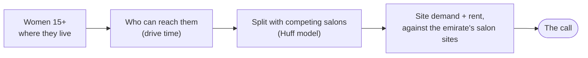

# Bedashing network right-sizing

Bedashing runs 24 beauty lounges across the UAE and has to decide which sites to keep, which to
look at again before their leases come up, and where a new lounge would win women it doesn't
reach today. This app estimates how many women a lounge at each site would serve, given the
competing salons nearby and what a shop there costs, and compares each site with the other salon
sites in its own emirate. At today's settings it says: protect 6 lounges, review 3 (not close)
and run a site search in 34 areas, each call with a written explanation whose numbers are checked
against the data.

**Live app:** https://2pz-ai-case-study-wr7zdmdumqywtp8bvpmbxm.streamlit.app/

Two terms used throughout. **Site demand**: the women a typical Bedashing lounge would serve at a
spot, after sharing them with every competing salon and sibling lounge they can reach, ranked
against the competitor salon sites in the same emirate. **Rent ratio**: the emirate's median salon-site
shop rent divided by this site's (above 1 = cheaper than a typical salon site there).

## The questions it answers

The app is for Bedashing's **retail portfolio team** (network, real estate, expansion) and the
**network and capital owner** on it. The answers below are the baseline (15-min drive, 60%
competitor coverage, 5.5% women in worker housing, affluence off); every count of women is a model
estimate.

1. **Which lounges should we keep, watch or review?**
   **6 PROTECT, 14 HOLD, 3 SHRINK** of 23 scored lounges (the airport lounge serves travellers and isn't scored).
   - PROTECT: Al Ain, Al Dhafra, Al Falah, Al Taif Mall, Mirdif 35, Nad Al Sheba.
   - SHRINK (investigate, don't close: we can't see profit): City Walk (bottom 30% of Dubai's salon
     sites on demand, rent ratio 0.47), West Yas (bottom 45% of Abu Dhabi's, 0.82) and Al Jada (top
     34% of Sharjah's on demand, but rent ratio 0.63: it sits on the dear Dubai edge of Sharjah).
   - 12 of the 23 calls are low confidence: close to a line, on a fallback rent, or moved by the
     assumptions (see Limitations).
   - **Where:** the Executive Summary's Review and Protect sections; the Lounges page for every lounge and its "What would change the call" tree.
2. **Where is there room for a new lounge?**
   **34 GROW areas** (and 63 WATCH, of 561 named places) pass all three tests: 6,000+ net new women, site demand in the emirate's top half, and a rent ratio of 1 or more.
   - By emirate: Abu Dhabi 13, Sharjah 10, Ajman 6, Ras Al Khaimah 4, Dubai 1 (Al Awir).
   - The biggest are Al Dhaid (+35% on the women our lounges serve today), Manama (+21%) and Khor Fakkan (+14%).
   - These figures can't be added up: neighbouring areas reach the same women.
   - 17 of the 34 have no shop rent of their own (they take the emirate median), so their rent test is neutral and the call low confidence.
   - Most Sharjah GROWs are beyond a 15-minute drive of our two Sharjah lounges (Al Jada, Zawaya Walk, both on the Dubai side); why the footprint there is two is a business question the model can't answer.
   - Most big WATCHes (Al Dhahir, Bani Yas, Al Helio) have the women but a rent dearer than their emirate's median salon site.
   - **Where:** the Executive Summary's Grow section; the Areas page; the What-if explorer's map (GROW areas in blue).
3. **Where do our own lounges compete for the same women?**
   Almost everywhere on the map, yet barely in effect.
   - 19 of 24 lounges share more than half their catchment with a sibling.
   - If one closes, its siblings pick up a median **8%** of its customers (30% at most). The rest go to competitors or nowhere.
   - **Lounges sharing a catchment both keep their call while women there go unserved.** A sibling only counts against a site for the women it actually wins; women still unserved, or with competitors, still count toward the site's demand. Of the 18 lounges sharing more than half their catchment, 15 are HOLD or PROTECT, and the 3 SHRINKs are there for rent or weak demand, not overlap. Khalifa City A, Shakhbout City and Mohammed Bin Zayed City share 97-100% of their catchments and are all HOLD.
   - **A new lounge can still be GROW inside our footprint**, judged on net new women only: 15 GROW areas are places our lounges already reach, such as Sharjah city (we serve 3% of its women; a new lounge would add about 12.8k net new).
   - So overlap isn't a reason to shrink, and expanding both lounges in a shared catchment can be right if it raises our coverage.
   - **Where:** each lounge page's shared-catchment table and cannibalisation what-if; the What-if explorer's "All catchments (overlap)" layer and **Test a SHRINK**.
4. **How does each lounge stand against the salons around it?**
   Site demand shares every area's women among our lounges and the 1,100+ premium competitor salons around them, then ranks the site against its emirate's competitor salon sites.
   - Example: City Walk out-serves only 30% of Dubai's salon sites; Al Dhafra out-serves all of Abu Dhabi's.
   - A lounge's own pull is shown beside its site, not scored: "The model estimates this lounge is performing 2.7x compared to its site" (Khalifa City A, a HOLD) separates a strong lounge from a strong location.
   - **Where:** each lounge page's signals, factor tree and competitors table; premium competitors on the What-if explorer's map.
5. **What would change the answers, and can the team test that themselves?**
   Yes, on the **What-if explorer**, the only page a what-if touches:
   - **Your decision rules** (how much risk to take): the weight of demand against rent, the PROTECT and SHRINK lines, the GROW minimum and demand line. A GROW minimum of 10,000 net new women cuts GROW from 34 to 16 areas.
   - **A rent quote** for a lounge or an area: a landlord quote of AED 2,200/m² for City Walk (today 4,561) turns it SHRINK → HOLD (low confidence).
   - **Test a SHRINK:** close one or more lounges and see who picks up their women and which calls move.
   - **The model's assumptions:** drive time, competitor coverage, women in worker housing, search recall.
   - The scenario summary shows baseline against scenario and what changed, with the signal that moved; the map colours every area by its call.

## How I approached it

**The framing.** I started from the person who decides: the network and capital owner, who decides
where Bedashing is present and how much capital each site ties up (open, renew, resize, relocate or
exit) and doesn't run the branches. So every call answers "is this a good place for our capital?",
never "is this branch well run?", and each label maps onto a decision they already make: PROTECT,
HOLD or SHRINK at a lounge's lease event, GROW as the start of a site search.

**Key decisions, and what each costs.**
- **Judge each site within its emirate**, against a frozen set of 1,123 competitor salon sites. Dubai
  and Abu Dhabi markets (and rent sources) aren't comparable, and a UAE-wide yardstick sank every dear
  Dubai site. Cost: a site is only as good as its emirate's yardstick; emirates with under 50 salon
  sites are ranked UAE-wide on demand.
- **Score the site, not the lounge's popularity.** Site demand puts a typical lounge (757 reviews,
  4.6★) at each spot, so a strong lounge can't hide a weak site. Cost: a well-run lounge on a weak
  site still reads SHRINK; its own performance is shown as context.
- **Rent as the cost signal.** It is the cost that differs most between sites (9.5x across our
  lounges) and the one a negotiation can move. Cost: no revenue, lease or capex, so SHRINK means
  "investigate".
- **Rules decide, AI explains.** Calls must be reproducible and defensible to a board; the AI drafts
  the memo, it never makes the call.
- **A hosted app with no keys.** The decision-maker opens a link; every lounge and area has its own
  URL, so a recommendation can be sent as a link to its evidence. Cost: the data is a committed
  snapshot, refreshed by re-running scripts.

**What I simplified, and why.** Midday drive times; lifetime Google reviews as each salon's pull;
one lounge format; no capacity; affluence off (household rents exist only for Dubai, and weighting
by them changes no lounge call). Each is there because the better data is Bedashing's own or not
public; [docs/model.md](docs/model.md) lists every one with its evidence.

**What I'd do next with Bedashing's data.** Bookings per lounge, to calibrate the demand model
(which today may under-read Dubai) and check the calls; actual leases and P&L, to turn SHRINK into a
return test; chairs and hours, to add capacity; then opening several sites at once and saving named
scenarios side by side ([docs/implementation.md](docs/implementation.md), Potential improvements).

## The AI layer, and why it's built this way

Every call comes with a pyramid: a one-sentence answer, 2-5 arguments, each backed by data points.
- **The code picks the arguments** (`src/explain.py:prioritize`): which signals matter and in what order is computed, not left to the model.
- **The model writes the prose; `verify()` checks it.** Every cited value must match the fact sheet and every number in the text must be a fact or a published threshold, correctly rounded. A failure falls back to a labelled template.
- **No key needed.** Explanations are cached, keyed by a hash of the exact numbers; when a what-if changes the numbers, the app shows the template instead of a stale text.
- **Why not a chatbot or an agent over the data?** A lease or capital call has to be defensible and reproducible: the same data must give the same call and the same reasons. So rules decide and the AI narrates under verification; an earlier LLM classifier was removed for that reason.
- **How AI built it:** agentic coding with Claude Code, with the human setting direction and signing off judgement calls, and every change gated by the tests, review passes and the sanity checks ([docs/implementation.md](docs/implementation.md)).

## How we checked it

- **Sanity checks and back-tests** ([`docs/sanity-checks.md`](docs/sanity-checks.md), re-run and logged after each model change): closing any sibling never pushes another lounge toward SHRINK (23 closures, 0 violations); +50% women in a catchment never lowers its call; 5 of 6 industrial, free-zone and military negative controls come out SKIP (the sixth, mixed-use Dubai Investments Park, is WATCH).
- **Tests:** 196, about 45 s (`just test`), including: default decision rules reproduce the baseline exactly; a rent quote rescores only that site; tightening the GROW minimum never adds a GROW.
- **Speed guards:** a full baseline run must stay under 8 s warm and 10 s cold (`tests/test_speed.py`).
- **No paid API by accident:** the only paid path must be asked for by name, and a test proves unknown arguments never reach it.
- **What we can't check:** there is no ground truth. Without bookings data the demand model is uncalibrated, so the calls are a ranked shortlist, not a forecast.

## Look at this in 5 minutes

1. **[Executive Summary](https://2pz-ai-case-study-wr7zdmdumqywtp8bvpmbxm.streamlit.app/):** the answer in one line, then the Review, Grow and Protect cards and their evidence maps.
2. **[What-if explorer](https://2pz-ai-case-study-wr7zdmdumqywtp8bvpmbxm.streamlit.app/explore):** pick Abu Dhabi, tick "All catchments (overlap)": heavy overlap, yet only West Yas is SHRINK.
3. **[City Walk](https://2pz-ai-case-study-wr7zdmdumqywtp8bvpmbxm.streamlit.app/lounge?lounge=city-walk) (SHRINK):** the AI pyramid, *What would change the call*, the factor tree and which siblings share its women.
4. **[Kalba](https://2pz-ai-case-study-wr7zdmdumqywtp8bvpmbxm.streamlit.app/area?area=kalba-sharjah) (GROW, low confidence):** about 12.5k net new women, but no shop rent of its own, and the call says so.
5. **Back on the What-if explorer:** open the 🧪 panel, quote City Walk a rent of 2,200 and watch its call move.
6. **[README](https://2pz-ai-case-study-wr7zdmdumqywtp8bvpmbxm.streamlit.app/how):** this page, the model and the implementation notes.

The full ten-minute version, with the AI layer and where not to trust it:
[`docs/walkthrough.md`](docs/walkthrough.md).

## Limitations

The calls are **a shortlist to test with the business, not decisions**, and the limitations matter
more than the calls. The biggest ones:

- **No revenue or lease data in the model.** The cost signal is a shop rent (an area median, a
  district rate or an asking rent, not the lease) against its emirate's median salon site. No revenue, lease terms, actual capex or footfall. **SHRINK means "investigate", not
  "close".**
- **Served demand rests on lifetime Google review counts.** Each salon's pull in the Huff split is
  its reviews, so older salons look bigger and new lounges look weak; the Huff parameters are an
  uncalibrated first cut.
- **Shop rent comes from different sources per emirate.** DLD contracts (Dubai), ADREC district
  rates read by hand off its public map (Abu Dhabi), Property Finder / Bayut asking rents scraped
  via third-party Apify actors, a grey area under those portals' terms (northern emirates), else the
  emirate median. The rent ratio compares a site only with its own emirate's salon sites. A cell on
  the emirate-median fallback has no rent of its own, so where it sets the rent the rent test is
  neutral and the call low confidence: 17 of the 34 GROW areas (9 in Sharjah) and two PROTECT
  lounges (Al Ain, Al Falah).
- **The calls move with the assumptions.** 12 of the 23 scored lounges are low confidence: 10
  within 0.05 of a line, plus Al Ain (fallback rent) and Jumeirah Park, whose calls change in 9 of
  the 27 drive-time x coverage x worker-share combinations. Affluence weighting is off at baseline: every woman counts the same.
- **Drive times are midday**, and the competitor search misses smaller salons where Google's
  20-result cap bites.
- **The yardstick and thresholds are judgement.** Both signals rank a site within its emirate
  against a frozen set of 1,123 competitor salon sites, valued by the same uncalibrated served model;
  emirates with under 50 such sites are ranked UAE-wide on demand. Every score is shown with its
  UAE-wide percentile as context.

The full ranked list, with which calls each limitation touches and what would fix it:
[`docs/limitations.md`](docs/limitations.md), also the app's **README** page.

## The model we'd build with Bedashing's data

The same decisions and the same chain (**demand → what we can serve → cost → return → the call**),
measured instead of estimated, and optimised for **services rendered per catchment**, not per branch:
- **The objective:** for each catchment region, match the **total capacity of all its branches**
  (service providers × hours × services per hour) to its demand, at the best **total capacity ÷ total
  rent** of those branches. Service providers are the capacity, so the first lever is allocating them
  to where demand is (add providers or hours where branches are full, move them from idle ones);
  opening, resizing or closing a branch is the move when that isn't enough.
- **Demand and capture:** bookings by customer home area, to measure the real catchment and penetration,
  and to calibrate the demand split on actual booking shares instead of Google reviews.
- **Capacity**, which today isn't modelled: chairs × hours × minutes per service, **utilisation**, peak
  utilisation and **turn-aways** (requests with no free slot). Served customers are the smaller of
  captured demand and capacity, so a full lounge losing customers reads very differently from a
  half-empty one, and two lounges in one catchment that both run full point to adding capacity, not
  consolidating.
- **Cost:** each lounge's base rent, service charge, fees and fit-out depreciation (fixed), and staff,
  commissions, products and booking fees per appointment (variable). From these: **contribution per
  appointment**, **break-even appointments** and **profit per m²**, the measured version of today's
  "demand per AED of rent".
- **The calls on those metrics:** PROTECT = top-quartile profit per m² and full; SHRINK = below
  break-even with low utilisation and customers its siblings can absorb; **expand in place** when an
  extra chair earns more than its rent; GROW = predicted appointments × contribution covers the rent
  quote, staff and fit-out within the payback period.

Full version: [docs/model.md](docs/model.md) ("The ideal model").

## Who it's for, and what it decides

**Who decides:** the network and capital owner, on the retail portfolio team. They decide where
Bedashing is present and how much capital each site ties up: open, renew, resize, relocate or exit.
They don't run the branches: service quality, staffing and day-to-day performance belong to
operations.

| Role | Who | Uses it to |
|---|---|---|
| **Primary user** | Bedashing's retail portfolio team (network, real estate, expansion) | form recommendations, stress-test them with what-ifs, lift the explanations into memos |
| **Decision-maker** | The network and capital owner, on the portfolio team | open, renew, resize, relocate or exit, from the headline and the reasons |
| **Operations** (out of scope) | Whoever runs the branches: service quality, staffing, day-to-day performance | nothing here: the tool never judges how a branch is run |
| **Board / investors** | Bedashing's board and investors | judge whether the call is defensible: evidence, thresholds, caveats |

Each label maps to a decision the network and capital owner already makes (definitions: [`docs/glossary.md`](docs/glossary.md), "Decisions"):

| Their decision | Label | What it asks |
|---|---|---|
| **Lease renewal, resize or exit** (each lounge, at its lease event) | **PROTECT** | Keep and defend: renew, don't relocate, respond to a competitor opening nearby |
| | **HOLD** | No portfolio action this cycle; revisit at the next lease event, or sooner if a signal crosses a line |
| | **SHRINK** | Investigate, don't close: before the lease event, review downsizing or consolidating into the sibling that shares most of its catchment |
| **Open** (site search, expansion plan) | **GROW** | Start a site search: a shortlist for site visits, verified on the ground before committing |
| **Revisit later** | **WATCH** | Don't act now; revisit when the named failing test changes |
| **No action** | **SKIP** | Too small or already crowded. (The airport lounge is NOT SCORED: it serves travellers.) |

**North star: services delivered**, the demand our lounges actually serve, bounded by their
capacity. The model can't measure it yet: its nearest proxy is served women, shown as context, and
**capacity is not modelled at all** (no chairs, hours or utilisation), so a SHRINK is driven by
modelled demand and shop rent, not by services that would be lost.

**One flow, question to action.** *"Which lounges should we review before their leases?"* →
Executive Summary, Review card: 3 SHRINKs, one per emirate → City Walk's page: a typical lounge
there would serve about 1.9k women, bottom 30% of Dubai's salon sites, rent ratio 0.47; 72% of its
catchment's women are also reached by a sibling; high confidence (holds in all 27 assumption
combinations) → action: put City Walk on the lease-review list with the sibling named, and ask
finance for its P&L before anyone says "close" (a prime rent may be buying footfall the model can't see).

## Out of scope, and why

Our job ends at **allocating lounges to neighbourhoods**: where the network should be denser,
thinner or new. Out of scope:

- **The P&L: revenue, actual rent paid, capex, lease terms.** We have none of it, and it is Bedashing's own
  data. It decides whether a SHRINK is closed; the model only says which lounges to look at.
- **In-branch staffing and capacity.** How many chairs and stylists a lounge needs is an
  operations question, answered from bookings, not from maps.
- **Service quality and operations.** Ratings enter only as part of each salon's pull in the
  Huff split; fixing a weak lounge's service is a management job, not a location one.

## How the model works



The rules make every call; the AI only narrates it. Constants are named in
[docs/model.md](docs/model.md), not quoted, because they are still being tuned: each lives in code
with a `*_WHY` string saying why. The full write-up, step by step, with the two detailed diagrams
(data to calls, and every signal including the dropped ones), every proxy, threshold, ignored
factor and assumption: [docs/model.md](docs/model.md). The AI layer, data pipeline, tools,
trade-offs and improvements: [docs/implementation.md](docs/implementation.md).

## Run it

Prerequisites: Python ≥ 3.11, [uv](https://docs.astral.sh/uv/) and (optional)
[just](https://just.systems/).

```bash
uv sync --extra dev
uv run streamlit run streamlit_app.py     # http://localhost:8501  (or: just app)
```

No API key needed: the app computes everything in memory from the committed `data/seed/v3/` and
serves the committed AI explanations. `just test` runs the tests. `just labels` prints every
lounge and growth-area call at the baseline as CSV. `just notebook` opens the notebooks (start
with `scorecard.ipynb`).

## Using the app

Five pages; the loop is **Executive Summary → click a lounge or area → its page → back**.

1. **Executive Summary** (`/`): the answer, three cards (Review, Grow, Protect) with their evidence maps and tables, then *How sure we are*.
2. **What-if explorer** (`/explore`): your decision rules, rent quotes, closures and the model's assumptions; the scenario summary and the map. The only page that reads a what-if.
3. **Lounges** (`/lounge?lounge=delma`): a sortable table of all 24; select one for its call, explanation, factor tree, competitors and shared catchment.
4. **Areas** (`/area?area=kalba-sharjah`): GROW and WATCH areas ranked by net new women, with the same detail.
5. **README** (`/how`): this README, the model and the implementation notes, then every assumption and constant read live from the code.

Links carry the selection, so any page can be shared directly. Page by page in detail:
[docs/implementation.md](docs/implementation.md); guided tour: [`docs/walkthrough.md`](docs/walkthrough.md).

## Repo map

```
streamlit_app.py         entry point; five pages in src/webapp/pages/: overview (Executive Summary),
                         predictions (What-if explorer), lounge, area, how (README)
src/webapp/              map layers, shared rendering, the what-if panel
src/data_v3.py           loads data/seed/v3/
src/market.py            women 15+ per cell (worker-housing rebalance), which Places results count as
                         women's salons, which competitors count as premium, the search-recall correction
src/model/served.py      Huff served demand, leave-one-out, open-a-lounge what-if
src/features/lounges.py  catchments, lounge features, site cost, salon-site reference signals (demand percentile, rent ratio), growth areas
src/model/scorecard.py   lounge signals, scales, weights, thresholds, confidence (with the reasons)
src/model/growth.py      GROW / WATCH / SKIP tests (with the reasons)
src/baseline.py          one in-memory run per what-if, and its diff against the baseline
src/explain.py           fact sheets, prioritisation, grounding check, cache, prompts
scripts/                 one-off fetches and builds (Google Places, Mapbox, WorldPop/OSM cells, GHSL, DLD rents, shop rents)
notebooks/               market_size, catchments, competitors, served_demand, rent, scorecard, growth, branches; features/: affluence, features, decisions, explanations
docs/limitations.md      ranked limitations: read first
docs/model.md            the model in detail: steps, proxies, ignored factors, assumptions and evidence
docs/implementation.md   the AI layer, data, tools, trade-offs, potential improvements
docs/glossary.md         glossary of domain terms and decisions
```

Commands: `just app` · `just test` · `just labels` · `just notebook` · `just explain`.
