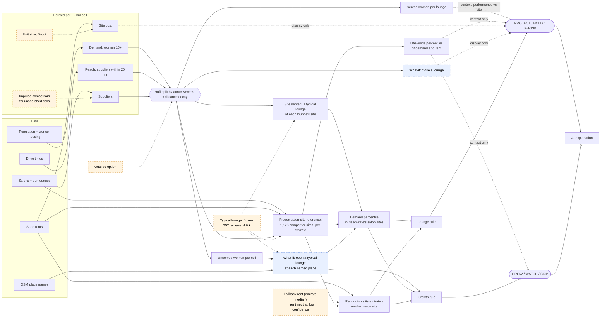
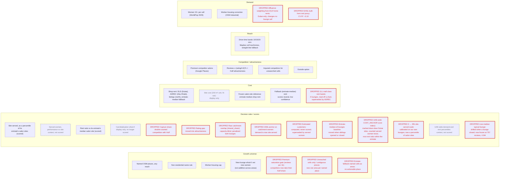

# The model in detail

The full write-up behind the README's short overview ([README](../README.md)): how each call is made, step by step, the proxies it rests on and the data that would replace them, what it ignores and why, and every assumption with its evidence. Implementation notes (the AI layer, data pipeline, tools, trade-offs, improvements) are in [docs/implementation.md](implementation.md).

## How a call is made, step by step

1. **Demand.** Women 15+ per ~2 km cell: WorldPop 2025 adults, rebalanced so OSM worker housing
   counts few women. Affluence weighting is **off**: it changes no lounge call (1-3 of 561 areas) and the data is Dubai-only
   (evidence: [`notebooks/features/affluence.ipynb`](../notebooks/features/affluence.ipynb)).
2. **Reach.** Which suppliers each cell reaches within 20 min, in 10/15/20-min bands: the cell's own
   Mapbox isochrones where fetched, elsewhere straight-line km bands fitted on those cells. Demand
   ignores emirate borders.
3. **Suppliers.** Premium competitor salons (Google Places), our lounges, and, for cells the salon
   search never covered, one imputed stand-in competitor sized like searched cells of the same
   emirate and density tier.
4. **Huff split.** Each cell's women are shared among the suppliers it reaches, by weight
   `reviews^ALPHA x (rating/4.6)^RATING_ELASTICITY x DECAY[band]`, plus an **outside option** (the
   median premium supplier's weight) standing for women who go elsewhere or don't buy premium. Out
   come **served women per lounge** and **unserved women per cell**. **Site served** re-runs the
   split with the lounge closed and a typical lounge at its site, frozen at 757 reviews and 4.6★
   (the 2026-10-11 medians of our scored lounges, `TYPICAL_WHY`)
   ([`notebooks/served_demand.ipynb`](../notebooks/served_demand.ipynb)).
5. **Cost.** Commercial shop rent per cell: Dubai from DLD Ejari shop contracts; Abu Dhabi from
   ADREC's 2025 district retail rates; northern emirates from Property Finder/Bayut asking rents
   (industrial areas dropped, at most 3 listings per building); otherwise the emirate median.
   A cell on that **fallback** has no rent of its own, so it never decides a call: a lounge whose
   site cell is on it scores rent neutral, and an area with `RENT_FALLBACK_MIN` or more of its
   rented women on it passes the rent test; both are low confidence (`RENT_FALLBACK_WHY`).
   Site cost = rent x `REF_UNIT_M2` + amortised fit-out (`FITOUT_AED_M2` over `FITOUT_YEARS`) is
   shown, not scored ([`notebooks/rent.ipynb`](../notebooks/rent.ipynb)).
6. **The yardstick: a frozen market of salon sites** (`SITE_REFERENCE_WHY`,
   `data/seed/v3/site_reference.csv`). Every real premium competitor salon (1,123; no imputed, no
   Bedashing), each with its cell's shop rent and the women a typical lounge would serve there with
   all our lounges open. Built once on 2026-10-11; nothing we open or close moves it, and our own
   lounges are never in it. Two signals rank a site within its emirate against it:
   **demand percentile** (`demand_pct`: the share of the emirate's reference sites it out-serves;
   UAE-wide for emirates under `MIN_REF_SITES`) and **rent ratio** (`rent_ratio`: the emirate's median
   reference rent ÷ the site's; above 1 = cheaper). Each comes with its UAE-wide percentile as
   context, not scored (`demand_pct_uae`, `rent_pct_uae`): "top 20% of Dubai salon sites on demand
   · 45th percentile UAE-wide".
7. **Lounge call** (`src/model/scorecard.py`). A composite of the demand percentile and the rent
   ratio scored on a frozen P10-P90 scale (`RENT_RATIO_P10`/`P90`), equal weights, both judging the
   site: PROTECT at `PROTECT_AT` or above, SHRINK at `SHRINK_AT` or below, HOLD between. Confidence
   is low within 0.05 of a line, on a fallback rent, or when a ±25% weight or a third of the 27
   drive-time x coverage x worker-share combinations change the call. Dropped on the way: a UAE-wide cost anchor
   (`COST_ANCHOR`: it marked down every dear Dubai site and counted served women twice) and an
   emirate-median-of-our-lounges baseline (it moved when a sibling opened or closed).
   **Cannibalisation** is a display-only what-if: close the lounge, what share of its women do
   siblings absorb ([`notebooks/scorecard.ipynb`](../notebooks/scorecard.ipynb)). **Performance vs
   site** (served women / site served) is context, not scored: "The model estimates this lounge is
   performing 2.7x compared to its site" (khalifa-city-a).
8. **Growth call** (`src/model/growth.py`). Areas are named OSM places (cells with only an emirate
   fallback name make no area). The what-if opens the same frozen typical lounge at each one: women it would serve, how many it takes from our lounges, **net new**. GROW
   if net new ≥ `NEW_SITE_MIN`, mostly not worker housing, rent ratio ≥ 1 (or unknown, or mostly
   the emirate-median fallback: neutral, low confidence) and demand
   percentile ≥ `DEMAND_PCT_MIN` in its emirate's salon sites; WATCH
   if it falls short on one of those or reaches half of `NEW_SITE_MIN`; SKIP otherwise, and always for
   non-residential names or places under `SKIP_UNDER_WOMEN`
   ([`notebooks/growth.ipynb`](../notebooks/growth.ipynb)). Net new is not additive across areas:
   each what-if runs alone, so neighbours claim the same women.
9. **Explanations.** Claude narrates each call from its fact sheet; it never makes the call ([the AI layer](implementation.md)).

**Key assumptions and known weaknesses** (full ranked list: [`docs/limitations.md`](limitations.md)):

- **The outside option is a convention, not a measurement.** Pegging it to the median premium
  supplier sets how much demand is "unserved"; a different peg moves every served count.
- **The what-if lounge is a median lounge.** A new site gets the median lounge's reviews and rating
  on day one, which flatters it (a new lounge has few reviews) and ignores size or format. It is
  frozen at the 2026-10-11 baseline (757 reviews, 4.6★), so closing a lounge never moves another's
  call through it.
- **Rents mix sources.** Dubai is contract rent, Abu Dhabi published rates, the north asking rents
  (which run above signed rents). The rent ratio keeps each site inside its emirate, but a site on
  the emirate-median fallback has no rent of its own: where it sets the rent (half or more of an
  area's women; a lounge's site cell), the rent test is neutral and the call low confidence.
- **Keep and grow use different bars.** Keep or shrink is judged within the emirate; growth needs
  an absolute 6,000 net new women. So a PROTECT site can fail the growth test as a new opening:
  nad-al-sheba is PROTECT, yet a typical lounge there would serve about 2,700 women.
- **Imputed competitors** stand in for unsearched cells: remote areas' competition is assumed, not seen.
- **No capacity cap.** A lounge can "serve" any number of women; chairs and staff never bind.

Other modelling choices that still hold:

- **One competitive set.** All lounges are treated as one format (same assumed price level and
  scorecard), because we have no data to split them by size, mall vs street or menu. The airport
  lounge gets no call (it serves travellers) and is left out as a supplier and a sibling.
- **Why driving.** The UAE is car-centric: low-density cities on wide arterial roads, malls with
  big car parks, public transport that covers only parts of the cities, and summer heat that
  makes walking to a salon rare. Mapbox's typical traffic for a **weekday 12:00** departure is a
  stated simplification: evening rush, when salon demand peaks, is ~40% slower in Dubai (TomTom
  2025), so real after-work reach is smaller.
- **Why a 0.02° grid.** Cells are ~2.2 x 2.0 km. Cell area varies by under 2% between 24° and
  26°N, where 97% of UAE adults live, and nothing computes an area in degrees: distances are
  haversine, sizes are people counts.

## The model in two diagrams

The first is the whole chain from data to calls; the second lists every signal behind it, including the ones we dropped, with the reason.

**The model: from data to calls**

*Dashed orange = an assumption, not data. Dashed blue = a what-if the model simulates.*

**Signals and features**

*Plain = in use. Red = dropped, with the reason. Grey dashed = demoted: still computed and shown,
no longer scored.*

## Every factor we ignore, and why

| Factor | What it was | Why it isn't used | What took its place |
|---|---|---|---|
| **Affluence weighting** | Women counted more where household rents are higher (DLD home rents as an income proxy) | Observed home rents exist for only **241 of 2,373 cells, all in Dubai**, so everywhere else would count as "average": it would tilt the model toward Dubai because of where the data happens to be, not where the money is. Switched on, it changes **no lounge call** and 1-3 of 561 area calls (notebooks/features/affluence.ipynb). It also barely relates to what we can observe (ρ ≈ 0.05-0.15 against reviews and ratings). We keep it only to correlate with other metrics | Every woman 15+ counts the same; a UAE-wide income proxy would let it back in (Potential improvements) |
| **Capture share** | The lounge's Google reviews as a share of its own plus its premium competitors' | The served-demand split already uses reviews to divide the market among competitors, so scoring capture as well counted competition twice. It also measures the lounge's popularity, not its site | Site demand (the site, scored); performance vs its site (the lounge, shown as context) |
| **Rating gap** | Its Google rating minus its competitors' median | Ratings sit in a narrow band (-0.2 to +0.3 stars), and in-branch quality is out of scope: we decide where capacity sits, not how a branch is run | Rating enters only as attractiveness in the demand split: (rating / 4.6)^5 |
| **Raw catchment overlap** (shared catchment) | The share of a lounge's catchment that another of our lounges also reaches, scored as cannibalisation | It penalised both lounges for any overlap, but overlap isn't cannibalisation: 19 of 24 lounges share 50%+ of their catchment, yet if one closes its siblings absorb a median 8% of its customers (30% at most). It also ignores capacity | The demand split shares women between lounges directly; the cannibalisation what-if is shown on each lounge page |
| **Catchment size on a 0-200k scale** | Women 15+ within the 15-min drive, scored by absolute size | Bigger catchments in crowded markets serve *fewer* women (ρ = -0.33 between catchment size and served women): size without competition misleads | Site demand, which accounts for competitors |
| **Estimated customers** | Capture × catchment women | Computed but never scored, and it gave a second, conflicting "women at stake" figure in the explanations | Served women (model estimate) |
| **Lounge's own served women as the demand score** | How many women this lounge serves | It largely restated the lounge's review count, so PROTECT meant "busy lounge" rather than "good site" | Site served: what a *typical* lounge would serve at the site |
| **0 → 20k site-served scale** | Site demand scored on a fixed scale | Calibrated on our own lounges, so it compared Dubai's crowded market with Abu Dhabi's | A percentile among the emirate's competitor salon sites |
| **Emirate-median-of-lounges cost baseline** | Cost judged against the median of the emirate's own lounges | Sharjah's two lounges were graded against each other, and closing a sibling flipped other calls (Zawaya Walk went HOLD → SHRINK when Al Jada closed) | A frozen reference of competitor salon sites |
| **UAE-wide cost anchor** | Served women per AED 1k of site cost against one UAE-wide number | Marked every dear Dubai site down without crediting Dubai's higher prices, and counted demand in both signals | Rent ratio within the emirate (rent only) |
| **Live-median "typical lounge"** | The what-if lounge took the median reviews and rating of whichever lounges were open | It drifted when a lounge closed (757 → 755 reviews), enough to tip Al Maqta's call | Frozen at 757 reviews and 4.6★ |
| **Premium saturation gate** (growth) | Reviews per 1,000 women as an "unsaturated" test | The demand split already gives competitors their share, so the gate counted competition twice | Net new women from the new-lounge what-if |
| **Unreached cells only** (growth) | Growth areas had to be beyond every lounge's drive time | An under-served area inside our footprint can still deserve a lounge | Every named place, judged by net new women |
| **Emirate-named cells as areas** | Cells with no place name, only an emirate | No actionable place to open in | Dropped from the growth list |
| **JLL mall-class rent bands** | Mall rent bands read off a chart | Covered 4 lounges, and were superseded by observed rents | DLD contracts, ADREC district rates, listings |
| **GHSL built-form rent proxy** | Predicting rent from building height and density | Cross-validated R² of -0.10: worse than guessing the average | Observed rents, else the emirate median (scored neutral) |

Demoted rather than dropped, so still shown as context: the lounge's own served women and performance vs its site, the cannibalisation what-if, the UAE-wide percentiles, and site cost in AED.

## Proxies today, and the signals we'd use with real data

We have no bookings, revenue, lease or capacity data, so every signal is a **proxy** for a business quantity. This section names each proxy and what replaces it, what healthy looks like with and without the data, and how we'd judge demand and capture once we have it.

### What each signal stands in for

| What we want to know | Proxy we use today (source) | Better signal once we have the data | Data needed |
|---|---|---|---|
| **Demand**: how many customers would book at this site | **Site demand**: women 15+ within a 10-20 min drive, split across premium salons by the Huff model (each salon's pull = its lifetime Google reviews × rating), ranked against the emirate's salon sites (WorldPop, Google Places, Mapbox) | Appointments per lounge per week; how many of the catchment's women book (penetration); new vs repeat customers | Booking-system export per lounge; customers' home area (postcode or loyalty data) |
| **Capture**: our share of the market we can reach | **Share of our served market** and **performance vs its site**, both from the same Huff split, which counts women, not customers, and uses reviews as popularity | Our appointments ÷ all premium salon appointments in the catchment (women × visit frequency × premium share) | Bookings; visit frequency and premium share from a survey or industry benchmark |
| **Cost to run** | **Site rent**: the area's shop rent × an assumed 150 m² unit + assumed fit-out of AED 3,000/m² over 5 years (DLD contracts, ADREC district rates, listings) | Each lounge's actual lease, service charge, staff, products and utilities, and fit-out depreciation | Per-lounge P&L and lease terms from finance |
| **Capacity**: how much we can serve | None | Chairs × opening hours; utilisation (booked ÷ available chair-hours) | Scheduling system |
| **Return**: whether a site pays | None (a return-on-capital gate can't be built from rent alone) | Profit per appointment, profit per m² per year, payback on fit-out, ROIC | P&L + capex per lounge |

### Why commercial rent stands in for cost

**Assumption: commercial rent is the biggest swing factor in what a branch costs to run, so it is the cost signal.** It may not be the largest cost line (staff often is), but it's the one that differs most *between* branches, and the calls compare branches. Shop rent at our lounge sites ranges **9.5x**, from about AED 480/m²/yr (Al Taif Mall, Fujairah) to AED 4,560 (City Walk, Dubai), around a median of about AED 1,730. Staff, products and utilities per appointment vary far less from site to site, and fit-out is assumed the same per m² everywhere, so those would shift every branch by a similar amount and barely change a ranking. If staff costs turn out to differ a lot between emirates (for example, Dubai wages or service charges), the per-lounge P&L in the table above replaces this assumption.

### What healthy and unhealthy look like

| | **Today, with proxies** | **With the data** (thresholds to agree with the business) |
|---|---|---|
| **Healthy (PROTECT)** | The site out-serves most of its emirate's salon sites and its rent is at or below their median: composite 0.65+ | Profit per m² above the network median, chairs well used, appointments flat or growing, fit-out paid back |
| **Watch (HOLD)** | Mixed: strong on one signal, weak on the other, composite 0.35-0.65 | Profitable but below the network median, or utilisation slipping |
| **Unhealthy (SHRINK)** | Weak demand for its emirate or rent well above the median: composite 0.35 or less. **Investigate, don't close**: we can't see profit | Loses money after its own rent and costs, low utilisation, appointments falling; and few of its customers would move to a sibling if it closed |
| **Lounge vs location** | Performance vs its site: above 1x, the lounge beats what a typical lounge would do there (popularity, from reviews); below 1x, it trails its site | The same comparison on appointments and profit, which separates a good site badly run from a bad site well run |
| **Grow** | A typical new lounge would add 6,000+ net new women, out-serve half the emirate's salon sites, at rent no dearer than their median | Predicted appointments × contribution per appointment covers rent and fit-out within an agreed payback period |

### Shared catchments aren't a reason to shrink

Two lounges whose catchments overlap compete for the same women. That doesn't mean one is redundant. **19 of 24 lounges share more than half their catchment with a sibling** (the median is 85%). Yet if one closes, its siblings pick up a median of only **8%** of its customers, and never more than 30%. The rest go to competitors or to nobody. In crowded markets, overlap mostly means we're both competing with other salons, not with each other.

So **expanding both lounges in a shared catchment can be right** if it raises our coverage of that market: when both are near capacity and the area still has unserved demand, more chairs at either lounge win customers from competitors rather than from each other. That's why cannibalisation is shown as a what-if on each lounge page, not scored. With capacity and booking data we'd judge it directly: utilisation at both lounges, and our combined share of the shared area before and after.

**How the model handles several lounges in one catchment.** The demand split shares each area's women
among every salon that reaches them, our lounges included. So a sibling only counts against a site for
the women it actually wins; women left unserved, or with competitors, still count toward what a lounge
at that site would serve. Two lounges in one catchment therefore both keep a healthy call as long as
women there go unserved, and a new lounge can still be GROW, because it is judged on **net new women**:
what it would add after our own lounges keep theirs.

- Of the 18 lounges sharing more than half their catchment with a sibling, **15 are HOLD or PROTECT**.
  The 3 SHRINKs (City Walk, Al Jada, West Yas) are there for dear rent or weak demand for their
  emirate, not for overlap.
- Khalifa City A, Shakhbout City and Mohammed Bin Zayed City share 97-100% of their catchments and are
  all HOLD; if any one closed, its siblings would absorb only 19-20% of its customers.
- **15 GROW areas are places our lounges already serve** (2% or more of their women), such as Sharjah
  city (3%, about 12.8k net new women for a new lounge), Kalba, Muntazy and Zakhir.

## The ideal model: the same decisions on Bedashing's own metrics

Today's model is a proxy for one we'd build with Bedashing's own data. The structure stays the same,
**demand → what we can serve → what it costs → what it returns → the call**, but every step is
measured instead of estimated. The two biggest upgrades are the cost side and **capacity**, which
today isn't modelled at all.

| Step | Today (proxy) | Ideal (Bedashing's data) |
|---|---|---|
| **Demand** | Women 15+ within a 10-20 min drive, split among salons by Google reviews (Huff) | Bookings by customer home area: the real catchment, penetration (customers ÷ women 15+) and repeat rate; the Huff split calibrated to observed booking shares instead of review counts |
| **Capture** | Share of our served market, from the same split | Our appointments ÷ the catchment's premium appointments (women × visit frequency × premium share) |
| **Capacity** | None | Chairs × opening hours × minutes per service = appointments a lounge can do; **utilisation** (booked ÷ available chair-hours), peak-hour utilisation, **turn-aways** (requests that found no slot) and lead time to the next free slot |
| **Cost** | Area shop rent × an assumed 150 m² unit + assumed fit-out | Per lounge: base rent, service charge and fees, fit-out depreciation (fixed); staff salaries, commissions and visas, products per service, booking-platform fees (variable per appointment) |
| **Return** | None | Contribution per appointment (ticket − variable cost); lounge profit; **profit per m²** and per chair-hour; payback and ROIC on fit-out |

### The cost side

- **Contribution per appointment** = average ticket − variable cost (therapist time and commission,
  products, platform fees). This is what one more customer is worth.
- **Break-even appointments** = fixed costs (rent, service charge, fees, fit-out depreciation) ÷
  contribution per appointment. The **margin of safety** is how far actual appointments sit above it.
- **Profit per m² per year** compares sites of different size and rent fairly. It is the measured
  version of today's "demand per AED of rent": rent stays the biggest swing factor, but now it is netted
  against what the site actually earns.

### Capacity: can a lounge take more customers?

Served customers are the smaller of the demand a lounge captures and the capacity it has. That one
line changes the calls:
- **Full** (high utilisation, turn-aways): demand is being lost. Protect it, and test adding capacity
  in place (more chairs or hours) before opening nearby: the marginal chair's contribution against
  the marginal rent of the extra space.
- **Headroom** (low utilisation): the lounge could serve more without new capital. A SHRINK here is
  a real candidate to downsize, especially if siblings have headroom to absorb its customers.
- **Shared catchments:** if two lounges both run full and the area still has unserved women, add
  capacity at both (or open). If both have headroom, consolidating is worth testing. Today's model
  can only see the second half of that (unserved women), not whether the lounges are full.

### The calls, on these metrics

- **PROTECT:** profit per m² in the top quartile and utilisation high (or turn-aways): a strong site
  that is earning and is full.
- **HOLD:** profitable but around the network median, or utilisation slipping: no capital move this cycle.
- **SHRINK:** below break-even after its own rent and costs, with low utilisation, and customers its
  siblings could absorb (measured from customers' booking history): review downsizing or consolidation.
- **Expand in place:** utilisation and turn-aways high, and an extra chair's contribution beats its
  extra rent.
- **GROW:** predicted appointments (calibrated demand × capture, net of what it takes from our own
  lounges) × contribution covers the quoted rent, staff and fit-out within an agreed payback period.

The What-if explorer's levers carry over unchanged: a landlord's rent quote would feed the cost side
directly, and the decision rules become hurdle rates (minimum profit per m², payback, utilisation).

## Decisions about the model

**What we left simple.** Midday drive times with a stepped, uncalibrated decay; lifetime reviews as
each salon's draw; the premium end only; Bedashing's price level assumed; affluence off; one lounge
format; no revenue and no capacity; cost as a shop rent (Dubai contract medians, Abu Dhabi
hand-read district rates, northern asking rents) against the emirate's median salon site;
growth areas merged by OSM place name, with cells that have no place within 3 km left out of them.

**How the problem is modelled.** Space: ~2 km cells carrying women 15+, grouped into drive-time catchments
and, outside them, into growth areas by OSM place name (one per name, contiguous or not). Lounges: two signals (demand
percentile and rent ratio, each within the emirate's frozen market of competitor salon sites) on
fixed 0-1 scales, weighted into one composite, cut at 0.35 and 0.65 into three labels. Areas: a
what-if (open a typical lounge) tested on net new women, worker housing, rent ratio and demand
percentile, into three labels.

**What we rely on, and what we don't.** Trusted: lounge locations (Google's pins; the store locator's
were off by up to 16 km), adult population, drive times. Not trusted: absolute served women (lifetime
reviews, uncalibrated Huff parameters, an estimated recall correction), Google price levels (36%
coverage), the women split outside Dubai, shop rents that are asking rents or emirate medians. And we didn't trust the AI to make the calls.

## Assumptions and evidence

Every assumption the data and market model rest on, with its evidence. Status: **in data** = fetched
and committed · **set** = a chosen value or rule, not measured · **estimate** = a calibrated guess, to
be replaced with better data.

| # | Assumption | Value | Evidence / reasoning | Status |
|---|---|---|---|---|
| 1 | **Which lounges exist** | 24 UAE lounges: Abu Dhabi 15, Dubai 5, Sharjah 2, RAK 1, Fujairah 1 | Bedashing's own store locator (bedashingbeauty.com/lounges). All 24 matched an operational Google Maps listing | in data |
| 2 | **Where each lounge is** | Google Maps pin, not the store locator's | The locator's pins are off by up to 16 km (Shahama 15.9, Al Ain 8.4, Nad Al Sheba 4.8 km); its street addresses agree with Google | in data |
| 3 | **Catchment = drive time** a customer will travel | 10 / **15** / 20 min (low / medium / high), Mapbox typical traffic at a weekday 12:00 departure. Competitors are searched within **2x** (30 min at medium): any salon a catchment resident can reach in 15 min is at most 30 min from the lounge | BrightLocal 2014 (US, 800+ consumers): ~14 min to a hair/beauty salon, women ~5 min more than men. Retail trade-area practice: the primary trade area (50-80% of customers) is a 5-15 min drive. No UAE-specific survey found. TomTom 2025: a Dubai trip takes ~40% longer at evening rush (27 vs 19 min per 10 km), so real catchments are smaller after work | in data |
| 4 | **Market size** of each ~2 km grid cell | Women aged 15+ | Only relative size matters. WorldPop 2025 gives adults per 100 m but a flat 33.6% female share everywhere, so the split is redone (row 13). Grid cells, not official neighbourhoods: OSM neighbourhoods cover only 66% of Dubai's women and none of Fujairah | in data |
| 5 | **How Bedashing's share is estimated** | **Capture** = the lounge's Google reviews ÷ (its reviews + its premium substitutes' reviews x a recall correction), inside its 15-min catchment. Estimated customers = capture x catchment women. Shown, not scored: served demand (Huff) replaced it | Reviews stand in for each salon's draw (revealed preference). Other Bedashing lounges count as substitutes, so overlapping lounges split shared demand. It measures share among premium substitutes, not market penetration. Rejected: splitting every cell among every salon that reaches it (~2,100 Google calls vs 72-144) | in data |
| 6 | **Review counts are lifetime totals** | Google `userRatingCount`, not adjusted for age | Older salons have had longer to collect reviews: a stated limitation. Partly a fair signal too: years of trading build a customer base. Per-year rates were considered and dropped: Google can't sort reviews oldest-first, so the first review needs a full scrape (unaffordable for competitors, and against Google's terms) | in data |
| 7 | **Ratings don't separate lounges** | Not a scored signal; part of each supplier's Huff pull, (rating / 4.6)^5 | Google ratings for the 24 lounges span 4.4-4.9 (median 4.6, std 0.12); 17 of 24 sit at 4.5 or 4.6. No link to review count (Spearman ρ = −0.22, p = 0.30) | in data |
| 8 | **Bedashing's price segment** | `expensive` (assumed) | Google has no price level for Bedashing's lounges; to be revisited from its own menu | set |
| 9 | **Premium substitutes** | Women's beauty, hair and nail salons in the catchment that Google prices expensive or very expensive; where Google has no price, those with reviews ≥ the catchment median and rating ≥ 4.3 | A shopper choosing Bedashing compares it with similar places, not budget salons. Google's price level is crowd-sourced spend per person and only 36% of the 2,824 candidates have it, so popularity and rating stand in. Salons priced expensive or above had twice the median reviews (165 vs 77) | in data |
| 10 | **How many substitutes** | The most-reviewed premium salons that together hold **60%** of the catchment's premium reviews (50% / 70% as sensitivity): 63 around Al Barsha, 2-3 in Al Dhafra | Reviews are concentrated in thin markets and spread out in dense ones: a fixed top 20 held 22% of reviews around Al Barsha but 66% around Al Taif Mall, so capture against a fixed k meant different things in each catchment. A coverage share makes lounges comparable. (Fixed k = 20 with 10/30 was the earlier design.) | in data |
| 11 | **Competitive set** | Women's beauty, hair and nail salons (Google primary type), found by 576 small-circle popularity searches over the 15-min catchments, plus 282 over the populated growth cells outside them. Men-only (incl. Arabic-named barbers), closed and non-salon places excluded, kept with a reason | No Google search ranks by review count; on a fully swept tile, small popularity circles found 17 of the true top-20 premium salons, one large text search 0-2. Home-service salons, common in the UAE, are invisible: a stated limitation | in data |
| 12 | **Airport lounge** | Gets no call (NOT SCORED), and is left out of every lounge's overlap, substitutes and nearest-lounge | It serves travellers, not a neighbourhood | set |
| 13 | **Female share in worker housing** | Adults in OSM industrial land use are 5.5% female (low 1% / high 15%); every other cell is rebalanced so each emirate's female total is unchanged | Dubai Statistics Center 2022: 13 labour-camp communities are 0.1-27% female (5.5% population-weighted), residential ones 43-54%. Against 21 measured communities, error falls from 0.21 (WorldPop's flat 33.6%) to 0.13. Camps not mapped as industrial in OSM are missed (DIP, very likely Sonapur), so Mirdif-35's market is overstated | in data |
| 14 | **Search recall (estimate)** | Where our search hit Google's 20-result cap, it found **66%** of premium reviews; substitutes' reviews are scaled by 1 + (share of full circles) x (1/0.66 − 1), from 1.03 to 1.39 | Calibrated on one fully swept ~8 km tile around Al Barsha (28.6k of 43.7k premium reviews found). An upper bound (that sweep missed salons too), and it assumes other dense areas behave like Al Barsha. Splitting the full circles instead was costed at ~$54-210 and declined. To be replaced if a full sweep is run | estimate |
| 15 | **Affluence = median household rent** | DLD Ejari contracts for one flat, villa or studio (labour camps, staff housing and bulk leases out), median per DLD area, mapped to cells by name; observed for 241 Dubai cells, neutral (1) everywhere else. **Off at baseline** (row 16) | Free, official and recent; rent is housing cost, not income or salon spend, and covers 3 months of registrations. A UAE-wide proxy from 2018 built form failed (CV R² −0.10). Abu Dhabi's ADREC data refused queries (HTTP 403); Sharjah publishes none | in data (Dubai only; what-if) |
| 16 | **How strongly demand follows rent** | Elasticity **0 (off, baseline)** / 0.5 / 1: weight = (rent / women-weighted median) ^ e, clipped to 0.25-4 before rescaling to a mean of 1 over observed cells (final weights 0.44-2.53 at 0.5, 0.18-2.68 at 1) | Off since 2026-10-11: it changed no call and only Dubai has the data (`notebooks/features/affluence.ipynb`). No data ties salon spend to rent; 0.5 says a cell with 4x the median rent counts 2x the women of a median-rent cell, before the rescale that keeps Dubai's observed total. Off reproduces the unweighted model exactly | set |

What these assumptions miss, ranked: [`docs/limitations.md`](limitations.md).
